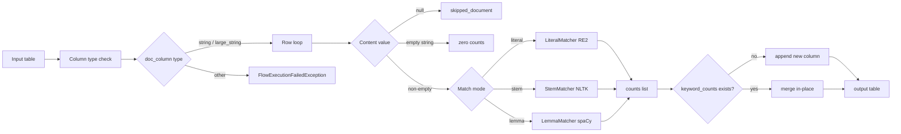

# KeywordCountOperator

Counts keyword and phrase occurrences in each document and writes per-document counts to a fixed map column.

- **Short Name:** `keyword_count`
- **Category:** Functional

---

## Overview

`KeywordCountOperator` scans each document for a configured list of keywords or phrases and records
how many times each keyword appears in a fixed column named `keyword_counts` of type
`map<string, int64>`.

Three matching modes are available:

- **`literal`** — RE2-based literal string search, optionally case-insensitive (default). Keywords
  are never interpreted as pattern syntax.
- **`stem`** — Snowball stemmer tokenization (NLTK). Inflections of the same root word match the
  keyword; phrase matches are whitespace-insensitive but punctuation-significant.
- **`lemma`** — spaCy pipeline lemmatization. Preserves contextual analysis. Requires an installed
  spaCy model package.

The operator appends `keyword_counts` to the table when the column is absent, or merges into it when
it already exists (e.g. when two `keyword_count` nodes run in sequence).

> **Privacy note:** No configured keyword or document text is written to logs, error messages, or
> telemetry attributes. Errors identify keywords by index only.

---

## Key Features

- Three matching modes: `literal` (default), `stem`, `lemma`
- Unicode normalization support: `NFC` (default), `NFKC`, or `none`
- Whole-word boundary enforcement (default: enabled)
- Case-insensitive matching (default for all modes; case-sensitive available in literal mode)
- Overlapping match counting (default: disabled)
- Fixed output column `keyword_counts` of type `map<string, int64>` — not configurable
- Merge behavior: existing counts are summed key-by-key; new keys are appended in configuration order
- Fail-closed: oversized linguistic documents, row-level errors, and configuration errors are
  recorded as failures — zero-count fallbacks are never silently substituted
- No network access or model downloads at runtime

---

## Operator Configuration

```json
{
  "type": "keyword_count",
  "name": "count_keywords",
  "config": {
    "keywords": ["contract", "liability", "indemnity"],
    "match_mode": "literal",
    "case_sensitive": false,
    "whole_word": true,
    "unicode_normalization": "NFC",
    "allow_overlapping": false,
    "doc_column": "content"
  },
  "depends_on": ["extract_documents"]
}
```

---

## Parameters

| Parameter | Type | Required | Default | Description |
|---|---|---|---|---|
| `keywords` | array of strings | Yes | — | Keywords to count. 1–20 entries, each at most 50 Unicode code points; combined total at most 1,000 code points. No leading/trailing whitespace. |
| `match_mode` | string | No | `"literal"` | Matching strategy: `literal`, `stem`, or `lemma`. |
| `language` | string | No | `"english"` | Snowball stemmer language (stem mode only). See supported languages below. |
| `lemmatizer_model` | string | No | — | Installed spaCy model package name (lemma mode only). Must be a plain Python identifier matching an installed package; paths and URLs are rejected. |
| `case_sensitive` | boolean | No | `false` | When `true`, matching is case-sensitive. Only valid in literal mode. |
| `whole_word` | boolean | No | `true` | When `true`, only match at word boundaries. Must be `true` for stem and lemma modes. |
| `unicode_normalization` | string | No | `"NFC"` | Normalization form applied to both keywords and document text before matching: `NFC`, `NFKC`, or `none`. |
| `allow_overlapping` | boolean | No | `false` | When `true`, overlapping matches are counted. By default, non-overlapping matching advances past each matched span. |
| `doc_column` | string | No | `"content"` | Name of the column containing document text. |

### Supported stem languages

`arabic`, `danish`, `dutch`, `english`, `finnish`, `french`, `german`, `hungarian`, `italian`,
`norwegian`, `portuguese`, `romanian`, `russian`, `spanish`, `swedish`

---

## Output Columns

| Column | Type | Description |
|---|---|---|
| `keyword_counts` | `map<string, int64>` | Maps each configured keyword to its occurrence count in the document. Keys appear in configuration order. Null for skipped (null-content) rows. |

### Map behavior

- **Absent column:** a new `keyword_counts` column is appended with counts for all configured keywords.
- **Existing column:** counts are merged key-by-key. Existing key order is preserved; new keys are
  appended in configuration order. Count addition uses checked 64-bit arithmetic — overflow fails
  the row and preserves the existing map unchanged.
- Null content rows produce a null map entry and are recorded as skipped.
- Empty string content rows produce a map with all keywords at count 0 and are counted as processed.
- Documents exceeding 1,000,000 characters in stem or lemma mode are recorded as failed with a null
  map entry. Literal mode has no document size limit.

---

## Examples

### Literal mode (default)

```json
{
  "type": "keyword_count",
  "name": "flag_legal_terms",
  "config": {
    "keywords": ["contract", "liability", "indemnity"],
    "match_mode": "literal",
    "whole_word": true
  },
  "depends_on": ["extract"]
}
```

### Stem mode — inflection matching

```json
{
  "type": "keyword_count",
  "name": "count_obligation_forms",
  "config": {
    "keywords": ["require", "comply", "terminate"],
    "match_mode": "stem",
    "language": "english"
  },
  "depends_on": ["extract"]
}
```

The keyword `require` will also match `requires`, `required`, and `requiring` because they share
the same English stem.

### Chained keyword_count nodes

Two sequential `keyword_count` nodes accumulate into the same `keyword_counts` column without
creating a duplicate field:

```json
[
  {
    "type": "keyword_count",
    "name": "legal_terms",
    "config": {"keywords": ["contract", "liability"]},
    "depends_on": ["extract"]
  },
  {
    "type": "keyword_count",
    "name": "risk_terms",
    "config": {"keywords": ["risk", "exposure"]},
    "depends_on": ["legal_terms"]
  }
]
```

The final `keyword_counts` map contains four keys from both operators.

---

## Troubleshooting

| Symptom | Cause | Fix |
|---|---|---|
| Validation error: "keywords requires between 1 and 20 entries" | More than 20 keywords configured | Split keywords across multiple `keyword_count` nodes |
| Validation error: "keywords at indices X and Y are equivalent" | Two keywords produce the same canonical key after normalization | Remove or rename the duplicate keyword |
| Validation error: "case_sensitive must be false for stem and lemma modes" | `case_sensitive: true` with stem or lemma mode | Use literal mode for case-sensitive matching |
| Validation error: "lemmatizer_model is not installed" | The named spaCy model package is not installed | Install the model with `python -m spacy download <model>` and restart |
| Validation error: "model does not provide usable lemmas" | Pipeline loaded but produced no tokens for the first keyword | Verify the installed model includes a lemmatizer component |
| Validation warning: "exceeding the recommended limit of 100" | More than 100 total keywords across all `keyword_count` nodes | Reduce total keywords; execution still proceeds |
| All counts are zero in stem mode | Keyword and document stems do not match | Check that `language` matches the document language; verify the keyword form with the stemmer |
| Literal mode does not match `straße` with `STRASSE` | RE2 simple Unicode case folding does not perform multi-character folds | Use NFKC normalization or lemma/stem mode for language-aware matching |

### Lemma mode memory and latency

Each `keyword_count` node in lemma mode loads a full spaCy pipeline per operator instance. With
micro-batching enabled (the default), up to `max_concurrent_batches` (default: 10) instances can
hold model copies concurrently. For memory-constrained environments:

- Lower `global_config.max_concurrent_batches` to 1–2.
- Or set `global_config.enable_micro_batching: false` to disable micro-batching entirely.

---

## Architecture


