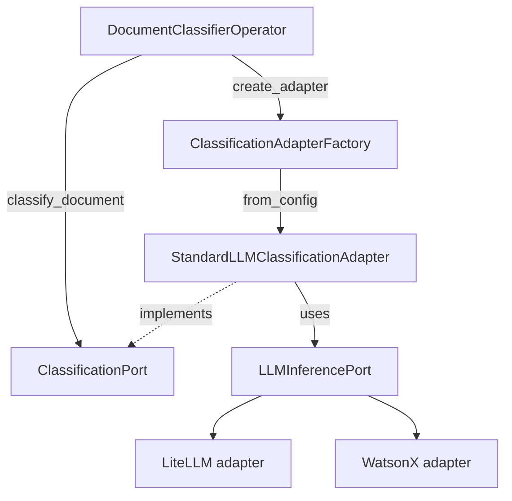

# DocumentClassificationOperator

Classifies documents into predefined types using LLMs with confidence scoring and optional reasoning.

- **Short Name:** `document_classifier`
- **Category:** Quality

---

## Overview

`DocumentClassificationOperator` uses an LLM (LiteLLM or WatsonX) to assign each document a
`document_type` label from a configurable list. It produces confidence scores and optional
reasoning text. Unsupported file formats are skipped, not failed.

---

## Key Features

- Multi-provider: LiteLLM (100+ providers including Ollama), IBM WatsonX
- Confidence scoring on a 1–10 scale
- Optional reasoning output
- Configurable document type lists (simple list or detailed descriptions)
- Parallel processing with configurable workers
- Unsupported file extensions are skipped (not failed), preserving pipeline continuity

---

## Breaking Changes

The classifier now sits behind `ClassificationPort`. These internal names were removed without
compatibility shims:

| Removed | Replacement |
|---|---|
| `docpipe.core.operators.quality.classification.classification_service.ClassificationService` | A `ClassificationPort` implementation resolved by `ClassificationAdapterFactory`, or pass `classification_adapter=` to `DocumentClassifierOperator` |
| `DocumentClassifierOperator.classification_service` | `DocumentClassifierOperator.adapter` |
| `DocumentClassifierOperator.model_id` and `.provider_config` | Read `model_id` / `provider_config` from the operator `config` |

Flow JSON is unaffected: default label output matches the previous behavior (see
[Label matching](#label-matching)).

---

## Architecture

### Hexagonal (Ports and Adapters) Architecture

The operator depends only on the `ClassificationPort` interface. A registry-based
`ClassificationAdapterFactory` resolves the flow `provider` string to a concrete adapter and
calls its `from_config()` classmethod, which validates the config and builds its own
dependencies.



### Component Responsibilities

#### 1. Operator ([`document_classifier.py`](../../../src/docpipe/core/operators/quality/classification/document_classifier.py))
- Handles PyArrow table processing and orchestration
- Manages parallel document classification
- Integrates with job tracking and progress reporting
- Calls only `ClassificationPort`; never imports concrete adapters
- Does not extract text itself: it passes `existing_text` (from the `content` column) and/or the raw `binary_content` to the adapter, which decides what it needs
- Writes the `_temp_content_for_extract` / `_temp_pages_processed` reuse columns only when the adapter reports `extracted_content` (see [Content reuse](#content-reuse-by-the-extract-operator))

#### 2. Port ([`classification_port.py`](../../../src/docpipe/core/operators/quality/classification/ports/outbound/classification_port.py))
- Defines `classify_document()` and the `from_config()` classmethod contract
- `ClassificationResponse` may carry optional `extracted_content` and `extraction_metadata` for adapters that extract text as a by-product

#### 3. Factory ([`classification_adapter_factory.py`](../../../src/docpipe/core/operators/quality/classification/adapters/outbound/factories/classification_adapter_factory.py))
- Registry of adapters keyed by `ADAPTER_NAME`; custom registered names are valid providers
- Alias table (`litellm`, `watsonx` resolve to the `standard` adapter)
- Rejects deprecated providers (`ollama`) with migration guidance

#### 4. Adapter ([`standard_llm_adapter.py`](../../../src/docpipe/core/operators/quality/classification/adapters/outbound/standard_llm_adapter.py))
- `StandardLLMClassificationAdapter` builds an `LLMInferencePort` through `LLMAdapterFactory` and performs prompt building, LLM call and response parsing
- Classifies from text: uses `existing_text` when given, otherwise extracts text from `binary_content` with Docling and returns it as `extracted_content` / `extraction_metadata`

#### 5. Domain ([`domain/models.py`](../../../src/docpipe/core/operators/quality/classification/domain/models.py))
- Pure domain models: `ClassificationRequest`, `ClassificationResponse`
- Provider-agnostic prompt building logic
- No infrastructure dependencies

### Adding a new adapter

Implement `ClassificationPort` (set `ADAPTER_NAME`, implement `from_config()` and
`classify_document()`) and decorate the class with `@register_classification_adapter`. The
decorator registers the adapter with `ClassificationAdapterFactory`; the module must be imported
(for example from `adapters/outbound/__init__.py`) for registration to occur. Select the adapter in a
flow with `"provider": "<ADAPTER_NAME>"`; no alias registration is needed.

Adapters that do not need Docling text (for example, ones that classify from raw bytes) simply
leave `extracted_content` and `extraction_metadata` as `None`; the operator then never runs
Docling and does not write the reuse columns.

### Content reuse by the Extract operator

When the input table has no `content` column and the adapter had to extract text itself (the
standard adapter does), the operator adds two temporary columns so a downstream
[Extract Operator](../extract/extract_operator_readme.md) can skip a second Docling pass:

| Column | Description |
|---|---|
| `_temp_content_for_extract` | Text extracted by the adapter |
| `_temp_pages_processed` | Native Docling `page_count`, or an estimate from character count |

The columns are written only when every document was extracted. If any document is skipped
(unsupported extension, blank extraction) or fails to fetch, neither column is added, so Extract
never sees mixed content.

---

## Supported Providers

### 1. LiteLLM (100+ LLM Providers)

**Use Case**: Unified interface for OpenAI, Anthropic, Azure, AWS Bedrock, Google, Ollama (via OpenAI-compatible API), and 100+ other providers

**Configuration Examples**:

**OpenAI:**
```json
{
  "provider": "litellm",
  "provider_config": {
    "model_id": "openai/gpt-4o-mini",
    "api_key": "${OPENAI_API_KEY}"
  }
}
```

**Ollama (via OpenAI-compatible API):**
```json
{
  "provider": "litellm",
  "provider_config": {
    "model_id": "openai/granite3.1-dense:8b",
    "api_base": "http://localhost:11434/v1",
    "api_key": "<ollama>" # pragma: allowlist secret
  }
}
```

**Supported Providers**:
- OpenAI (openai/gpt-4, openai/gpt-4o-mini, openai/gpt-3.5-turbo)
- Anthropic (anthropic/claude-3-opus, anthropic/claude-3-sonnet, anthropic/claude-3-haiku)
- Azure OpenAI (azure/gpt-4)
- AWS Bedrock (bedrock/anthropic.claude-3-sonnet)
- Google Vertex AI (vertex_ai/gemini-pro)
- HuggingFace (huggingface/meta-llama/Llama-3.3-70B-Instruct)
- **Ollama via OpenAI-compatible endpoint** (openai/llama3.2:latest, openai/granite3.1-dense:8b with api_base)
- Cohere, Replicate, and 100+ more

**Requirements**:
- Valid API key for chosen provider (or "ollama" for local Ollama)
- Network access to API endpoint
- For Ollama: Server running on `http://localhost:11434`

**Advantages**:
- Single interface for 100+ providers
- Easy provider switching
- High-quality classifications
- Automatic retry and fallback support
- Local Ollama support via OpenAI-compatible API

### 2. Watsonx (IBM Watsonx.ai)

**Use Case**: Enterprise deployments with IBM Cloud infrastructure

**Configuration**:
```json
{
  "provider": "watsonx",
  "provider_config": {
    "model_id": "ibm/granite-13b-chat-v2",
    "api_base": "https://us-south.ml.cloud.ibm.com",
    "api_key": "${WATSONX_API_KEY}",
    "container_kind": "project",
    "container_id": "${WATSONX_PROJECT_ID}"
  }
}
```

**Requirements**:
- IBM Cloud account
- Watsonx.ai project or space
- Valid API key

**Advantages**:
- Enterprise-grade security
- Compliance certifications
- IBM support

---

## Configuration Parameters

### Required Parameters

| Parameter | Type | Description |
|-----------|------|-------------|
| `provider` | string | LLM provider: `"litellm"` or `"watsonx"`. A custom adapter registered with `@register_classification_adapter` is selected by its `ADAPTER_NAME` |
| `model_id` | string | Text model identifier (inside `provider_config`). For LiteLLM: `"openai/granite3.1-dense:8b"`; for WatsonX: `"ibm/granite-13b-chat-v2"` |

### Optional Parameters

| Parameter | Type | Default | Description |
|-----------|------|---------|-------------|
| `document_types` | list or dict | Auto-loaded | Document types to classify into |
| `confidence_threshold` | float | 7.0 | Minimum confidence for classification (1-10) |
| `doc_column` | string | `"content"` | Column containing document text |
| `output_column` | string | `"document_type"` | Column name for classification result |
| `include_confidence` | boolean | true | Include confidence score in output |
| `include_reasoning` | boolean | false | Include reasoning explanation in output |
| `max_content_length` | integer | 2000 | Maximum content length to send to LLM |
| `strict_label_matching` | boolean | false | Write the configured spelling of the matched document type and reject labels that match none (output `None`). When false, any label is accepted and normalised to lower-case with underscores. See [Label matching](#label-matching) |
| `max_workers` | integer | Auto | Number of parallel workers |
| `use_processes` | boolean | false | Use processes instead of threads |

### Provider-Specific Configuration

#### LiteLLM
```json
{
  "provider": "litellm",
  "provider_config": {
    "model_id": "openai/gpt-4o-mini",
    "api_key": "${OPENAI_API_KEY}",
    "timeout": 120
  }
}
```

**Examples for different providers**:
```json
// OpenAI
{"provider": "litellm", "provider_config": {"model_id": "openai/gpt-4o-mini"}}

// Anthropic
{"provider": "litellm", "provider_config": {"model_id": "anthropic/claude-3-sonnet-20240229"}}

// Azure OpenAI
{"provider": "litellm", "provider_config": {"model_id": "azure/gpt-4"}}

// AWS Bedrock
{"provider": "litellm", "provider_config": {"model_id": "bedrock/anthropic.claude-3-sonnet"}}

// Google Vertex AI
{"provider": "litellm", "provider_config": {"model_id": "vertex_ai/gemini-pro"}}

// Ollama via OpenAI-compatible endpoint
{"provider": "litellm", "provider_config": {"model_id": "openai/llama3.2:latest", "api_base": "http://localhost:11434/v1"}}
{"provider": "litellm", "provider_config": {"model_id": "openai/granite3.1-dense:8b", "api_base": "http://localhost:11434/v1"}}

// HuggingFace
{"provider": "litellm", "provider_config": {"model_id": "huggingface/meta-llama/Llama-3.3-70B-Instruct"}}
```

#### Watsonx
```json
{
  "provider": "watsonx",
  "provider_config": {
    "model_id": "ibm/granite-13b-chat-v2",
    "api_base": "https://us-south.ml.cloud.ibm.com",
    "api_key": "${WATSONX_API_KEY}",
    "container_kind": "project",
    "container_id": "${WATSONX_PROJECT_ID}",
    "timeout": 120
  }
}
```

---

## Document Types Configuration

### Simple List Format

```json
{
  "document_types": [
    "invoice",
    "receipt",
    "contract",
    "report",
    "letter"
  ]
}
```

### Detailed Dictionary Format (Recommended)

```json
{
  "document_types": {
    "invoice": "Business invoice with line items, totals, and payment terms",
    "receipt": "Payment receipt or transaction confirmation",
    "contract": "Legal contract or agreement document",
    "report": "Business or technical report with analysis and findings",
    "letter": "Formal or informal correspondence letter",
    "email": "Email correspondence or message",
    "form": "Form or application document requiring completion",
    "purchase_order": "Purchase order for goods or services",
    "other": "Other document types not fitting above categories"
  }
}
```

**Benefits of Dictionary Format**:
- More accurate classifications
- Better handling of ambiguous documents
- Improved confidence scores

### Label matching

By default the label returned by the model is written as `label.lower().replace(" ", "_")` and any
label is accepted. For example, with a type named `"Purchase Order"`, a model answer of
`purchase_order` is written as `"purchase_order"`, and `"Expense Report"` is written as
`"expense_report"` even if you configured `"Expense Reports"`.

Set `strict_label_matching` to `true` to match the label against your document types ignoring case,
spaces and underscores and write the type exactly as you spelled it (`"Purchase Order"` in the
example above). If the label matches none of the configured types, the output is `None` and the
reasoning column explains which label was rejected.

---

## Input Requirements

### Supported File Extensions

The operator validates file extensions and only processes documents with the following formats:
- **PDF**: `.pdf`
- **Microsoft Word**: `.docx`, `.doc`
- **Microsoft PowerPoint**: `.pptx`, `.ppt`

**Unsupported formats** are automatically **skipped** (not classified) but remain in the output table with `None` classification values. These documents are tracked as skipped documents in the operator metadata.

### Input Schema

- PyArrow Table with document content
- Required: `name` column containing filename (used for extension validation)
- Optional: `content` column (if not present, the raw document bytes are fetched and passed to the adapter, which extracts text when it needs to)

## Output Columns

All input columns are preserved. The operator appends:

| Column | PyArrow Type | Description |
|---|---|---|
| `document_type` | `string` | Classified document type label |
| `document_type_confidence` | `float32` | Confidence score (1–10); present when `include_confidence: true` |
| `document_type_reasoning` | `string` | Explanation for the classification; present when `include_reasoning: true` |
| `_temp_content_for_extract` | `string` | Internal reuse column for the Extract operator; added only when no `content` column was supplied and the adapter extracted text for every document |
| `_temp_pages_processed` | `int` | Internal reuse column; added together with `_temp_content_for_extract` |

**Note:** Documents with unsupported file extensions are not removed — they remain in the output table with `None` values in the classification columns and are tracked in `skipped_docs` metadata.

---

## Input Schema

| Column | Type | Required | Description |
|---|---|---|---|
| `name` | string | Yes | Filename — used for file extension validation |
| `content` | string | No | Document text; if absent, binary content is fetched and the adapter extracts text from it |

---

## Output Schema (legacy)

The operator adds the following columns to the output table:

| Column | Type | Description | Always Present |
|--------|------|-------------|----------------|
| `document_type` | string | Classified document type | Yes |
| `document_type_confidence` | float | Confidence score (1-10) | If `include_confidence=true` |
| `document_type_reasoning` | string | Classification explanation | If `include_reasoning=true` |
| `_temp_content_for_extract` | string | Text extracted by the adapter, for reuse by Extract | Only when adapter extracted all documents |
| `_temp_pages_processed` | int | Page count for the extracted text | Only with `_temp_content_for_extract` |

### Metadata

The operator provides detailed processing statistics in metadata:

| Field | Type | Description |
|-------|------|-------------|
| `processed_docs` | integer | Number of successfully classified documents |
| `failed_docs` | list | List of failed document paths with failure reasons |
| `failed_docs_count` | integer | Total number of failed documents |
| `skipped_docs` | list | List of skipped document paths with skip reasons |
| `skipped_docs_count` | integer | Total number of skipped documents |

**Note**: Documents with unsupported file extensions are included in `skipped_docs` (not `failed_docs`) with the reason "Unsupported file extension". These documents remain in the output table with `None` classification values.

### Example Output

```python
{
  "id": "doc_001",
  "name": "invoice_2024.pdf",
  "content": "INVOICE\nDate: 2024-01-15\nTotal: $1,234.56...",
  "document_type": "invoice",
  "document_type_confidence": 9.5,
  "document_type_reasoning": "Document contains invoice header, line items, totals, and payment terms typical of business invoices"
}
```

---

## Examples

### Example 1: Basic Classification with LiteLLM (Ollama via OpenAI-compatible API)

```json
{
  "id": "classify_node",
  "name": "classify",
  "operator": "document_classifier",
  "config": {
    "provider": "litellm",
    "provider_config": {
      "model_id": "openai/granite3.1-dense:8b",
      "api_base": "http://localhost:11434/v1",
      "api_key": "<ollama>" # pragma: allowlist secret
    },
    "document_types": ["invoice", "receipt", "contract", "report"],
    "confidence_threshold": 7.0,
    "include_confidence": true,
    "include_reasoning": false
  }
}
```

### Example 2: Detailed Classification with LiteLLM (OpenAI)

```json
{
  "id": "classify_node",
  "name": "classify",
  "operator": "document_classifier",
  "config": {
    "provider": "litellm",
    "provider_config": {
      "model_id": "openai/gpt-4o-mini",
      "api_key": "${OPENAI_API_KEY}"
    },
    "document_types": {
      "invoice": "Business invoice with line items and totals",
      "receipt": "Payment receipt or confirmation",
      "contract": "Legal contract or agreement",
      "report": "Business or technical report"
    },
    "confidence_threshold": 8.0,
    "include_confidence": true,
    "include_reasoning": true,
    "max_content_length": 4000
  }
}
```

### Example 3: Enterprise Classification with Watsonx

```json
{
  "id": "classify_node",
  "name": "classify",
  "operator": "document_classifier",
  "config": {
    "provider": "watsonx",
    "provider_config": {
      "model_id": "ibm/granite-13b-chat-v2",
      "api_base": "https://us-south.ml.cloud.ibm.com",
      "api_key": "${WATSONX_API_KEY}",
      "container_kind": "project",
      "container_id": "${WATSONX_PROJECT_ID}"
    },
    "document_types": {
      "invoice": "Business invoice document",
      "contract": "Legal contract or agreement",
      "report": "Business report or analysis"
    },
    "confidence_threshold": 7.5,
    "include_confidence": true,
    "include_reasoning": true
  }
}
```

### Example 4: Complete Flow with Classification

```json
{
  "flow_name": "Document Classification Pipeline",
  "description": "Classify documents using LiteLLM with Ollama",
  "global_config": {
    "doc_column": "content"
  },
  "flow": [
    {
      "name": "ingest",
      "type": "ingest_source",
      "config": {
        "provider": "filesystem",
        "connection_params": {"paths": ["./documents"]}
      }
    },
    {
      "name": "extract",
      "type": "extract_operator",
      "depends_on": ["ingest"],
      "config": {
        "doc_column": "content"
      }
    },
    {
      "name": "classify",
      "type": "document_classifier",
      "depends_on": ["extract"],
      "config": {
        "provider": "litellm",
        "provider_config": {
          "model_id": "openai/granite3.1-dense:8b",
          "api_base": "http://localhost:11434/v1",
          "api_key": "<ollama>" # pragma: allowlist secret
        },
        "document_types": {
          "invoice": "Business invoice with line items",
          "receipt": "Payment receipt",
          "contract": "Legal contract",
          "other": "Other document types"
        },
        "confidence_threshold": 7.0,
        "include_confidence": true,
        "include_reasoning": true
      }
    }
  ]
}
```

---

## Best Practices

### 1. Document Type Definitions

**DO**:
- Use descriptive document type names
- Provide detailed descriptions in dictionary format
- Include an "other" category for unclassified documents
- Keep type count reasonable (5-15 types optimal)

**DON'T**:
- Use overly similar type names
- Create too many granular categories
- Use ambiguous descriptions

### 2. Confidence Threshold

- **7.0-8.0**: Balanced accuracy and coverage (recommended)
- **8.0-9.0**: High precision, may miss some documents
- **6.0-7.0**: High recall, may include false positives

### 3. Content Length

- **2000 chars**: Fast, good for simple documents
- **4000 chars**: Balanced, works for most documents
- **8000+ chars**: Detailed analysis, slower processing

### 4. Provider Selection

| Use Case | Recommended Provider |
|----------|---------------------|
| Local/Privacy | LiteLLM with Ollama (via OpenAI-compatible API) |
| High Accuracy | LiteLLM (GPT-4, Claude-3-Opus) |
| Enterprise | Watsonx or LiteLLM (Azure/Bedrock) |
| Cost-Effective | LiteLLM with Ollama or LiteLLM (GPT-4o-mini) |
| Multi-Provider | LiteLLM (100+ providers) |

### 5. Performance Optimization

```json
{
  "max_workers": 4,
  "use_processes": false,
  "max_content_length": 2000
}
```

- Use threads for I/O-bound operations (API calls)
- Adjust `max_workers` based on API rate limits
- Reduce `max_content_length` for faster processing

---

---

## Troubleshooting

### Issue: "Failed to initialize classification adapter"

**Cause**: Missing or invalid provider configuration

**Solution**:
- Verify provider name is correct (`litellm`, `watsonx`); any other value fails at construction with the list of supported providers
- `provider_config` is required for `litellm`; for `watsonx` it may be omitted when the `WATSONX_*` environment variables are set
- Check all required provider_config parameters
- Ensure API keys and endpoints are valid
- For LiteLLM, verify model ID format matches provider (e.g., `openai/gpt-4o-mini`, `anthropic/claude-3-sonnet-20240229`)
- For Ollama via LiteLLM, ensure api_base is set to `http://localhost:11434/v1`

### Issue: Low confidence scores

**Cause**: Ambiguous document types or insufficient descriptions

**Solution**:
- Use dictionary format with detailed descriptions
- Reduce number of similar document types
- Increase `max_content_length` for more context

### Issue: "Empty content for document"

**Cause**: Document content not extracted or column name mismatch

**Solution**:
- Ensure `extract_operator` runs before classification
- Verify `doc_column` matches extraction output
- Check document extraction was successful

### Issue: Slow processing

**Cause**: Large documents or sequential processing

**Solution**:
- Reduce `max_content_length`
- Increase `max_workers` (respect API rate limits)
- Use faster models (e.g., `gpt-4o-mini` instead of `gpt-4`)

### Issue: Ollama connection failed

**Cause**: Ollama server not running

**Solution**:
```bash
# Start Ollama server
ollama serve

# Pull required model
ollama pull granite4:latest

# Verify server is running
curl http://localhost:11434/api/tags
```

---

## Sample Flows

- [`sample_flows/operators/classification_ollama.json`](../../../sample_flows/operators/classification_ollama.json): Ollama provider example

---

## API Reference

### ClassificationPort

Outbound port that every classification adapter implements. Adapters are resolved by
`ClassificationAdapterFactory`, which dispatches to the adapter's `from_config()` classmethod.

```python
class ClassificationPort(ABC):
    ADAPTER_NAME: str
    ADAPTER_DISPLAY_NAME: str

    @classmethod
    @abstractmethod
    def from_config(cls, config: dict[str, Any]) -> Self:
        """Validate config, build dependencies, and return a ready adapter."""

    @abstractmethod
    def classify_document(
        self,
        *,
        doc_name: str,
        binary_content: bytes | None,
        existing_text: str | None,
        document_types: list[str] | dict[str, str],
    ) -> ClassificationResponse:
        """Classify a single document and return a structured response."""
```

### StandardLLMClassificationAdapter

Built-in adapter serving the `litellm` and `watsonx` providers. It
builds its `LLMInferencePort` through `LLMAdapterFactory` in `from_config()`. When it extracts text itself
it honors the flow's `doc_format` (`markdown` by default, or `doclang`). See the
[Architecture](#architecture) section for how the operator, factory, and adapter interact.

### Domain Models

```python
@dataclass
class ClassificationRequest:
    content: str
    document_types: list[str] | dict[str, str]
    max_content_length: int = 2000
    confidence_threshold: float = 7.0

@dataclass
class ClassificationResponse:
    document_type: str | None  # normalised label; with strict_label_matching, None when not a configured type
    confidence: float
    reasoning: str
    success: bool
    error: str | None = None
    extracted_content: str | None = None  # text the adapter extracted itself (e.g. via Docling)
    extraction_metadata: dict[str, Any] | None = None  # e.g. Docling page_count

@dataclass
class ModelInfo:
    name: str
    provider: str
    supports_json_mode: bool = True
    max_tokens: int = 4096
```

The module `domain/models.py` also exposes the reusable pure functions `build_classification_prompt()`,
`parse_classification_response()` (raw LLM text to `ClassificationResponse`: JSON parse, required-field
check, confidence clamp), `normalize_label()` (lower-case, spaces to underscores) and
`resolve_document_type()` (maps a returned label onto the configured types, used with `strict_label_matching`).

---

## Related Documentation

- [Extract Operator](../extract/extract_operator_readme.md) - Document content extraction
- [Embeddings Operator](../functional/embeddings_readme.md) - Vector embeddings generation
- [Architecture Guide](../../../ARCHITECTURE.md) - System architecture overview
- [Operator Reference](../../reference/OPERATORS.md) - Complete operator API reference

---

## Version History

- **v3.0.0** : Hexagonal port/adapter architecture
  - Operator depends only on `ClassificationPort`; adapters are resolved by `ClassificationAdapterFactory`
  - Built-in `StandardLLMClassificationAdapter` serves the `litellm` and `watsonx` providers
  - Adapters self-register via `@register_classification_adapter`
  - `provider_config` is required for `litellm` and optional for `watsonx` (environment-variable credentials); its metadata flag is `required: false` and the adapter enforces the `litellm` rule
  - Unsupported providers raise at construction instead of silently falling back to `litellm`
  - Optional `strict_label_matching` resolves the returned label against `document_types`; unmatched labels yield `None`
  - Registered `ADAPTER_NAME` values are accepted as `provider` values
- **v2.1.0** : Dependency injection and pluggable document class provider
  - The classifier accepts an optional pre-built `LLMInferencePort`, bypassing `LLMAdapterFactory`
  - Added `DocumentClassProvider` port; default `StaticDocumentClassProvider` preserves existing local-file behaviour
  - Classification and entity extraction adapters accept `document_class_provider=` for injecting custom metadata sources
- **v2.0.0** : Shared LLM infrastructure
  - Leverages shared LLM infrastructure (`LLMAdapterFactory`)
  - Removed standalone Ollama provider (use LiteLLM with OpenAI-compatible API instead)
  - Supports LiteLLM (100+ providers) and Watsonx
- **v1.1.0** : LiteLLM integration
  - Replaced OpenAI adapter with LiteLLM adapter
  - Support for 100+ LLM providers (OpenAI, Anthropic, Azure, AWS Bedrock, Google, etc.)
  - Unified interface for all providers
- **v1.0.0** : Initial release
  - Ollama, LiteLLM, and Watsonx providers
  - Confidence scoring and reasoning
