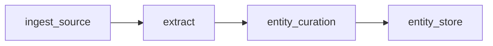

# EntityStoreOperator

Stores the curated entities of each document in DuckDB or PostgreSQL tables and passes the data through unchanged.

- **Short Name:** `entity_store`
- **Category:** Storage

---

## Overview

`EntityStoreOperator` reads the curated entities that `EntityCurationOperator` writes to the
`transformed_entities` column. Each key of that JSON object names an entity table. A JSON object
becomes one row of its table, and a list of objects becomes one row per object.

Tables are created on first use and gain new columns when documents bring new fields. Rows are
upserted by `id`, so running the same flow again updates the rows instead of duplicating them.
The operator returns the input table unchanged.

---

## Key Features

- DuckDB (file or in-memory) and PostgreSQL backends behind `TableStoragePort`
- One table per entity type, with the configurable `table_prefix` (default `entity_`)
- PostgreSQL tables in their own schema (default `docpipe_entities`), created if needed
- Upsert by a row `id` built from the document id, so re-runs are idempotent
- Automatic schema evolution when documents bring new fields
- Per-document error handling: a document or table that cannot be stored fails only the affected documents
- No credentials in the flow: the PostgreSQL connection comes from the `DOCPIPE_POSTGRES_*` environment variables

---

## Operator Configuration

```json
{
  "type": "entity_store",
  "name": "store_entities",
  "config": {
    "data_backend": "postgres",
    "schema": "docpipe_entities",
    "table_prefix": "entity_"
  },
  "depends_on": ["entity_curation"]
}
```

---

## Parameters

| Parameter | Type | Required | Default | Description |
|---|---|---|---|---|
| `data_backend` | string | No | `duckdb` | Database that stores the entities: `duckdb` or `postgres` |
| `database_path` | string | No | `:memory:` | DuckDB database file, or `:memory:`. Used by the `duckdb` backend |
| `schema` | string | No | `docpipe_entities` | PostgreSQL schema of the entity tables. Used by the `postgres` backend |
| `table_prefix` | string | No | `entity_` | Prefix of every entity table name. Letters, digits and underscores only |
| `entities_column` | string | No | `transformed_entities` | Column that holds the curated entities of each document |

The `postgres` backend connects with these environment variables:

| Variable | Default | Description |
|---|---|---|
| `DOCPIPE_POSTGRES_HOST` | `localhost` | Server host |
| `DOCPIPE_POSTGRES_PORT` | `5432` | Server port |
| `DOCPIPE_POSTGRES_DB` | `docpipe` | Database name |
| `DOCPIPE_POSTGRES_USER` | `docpipe_user` | User name |
| `DOCPIPE_POSTGRES_PASSWORD` | — | Password (required) |

Connection settings in the operator configuration are rejected: the flow configuration is stored
with every run.

---

## Output Columns

This operator does not add or remove columns. The original input table is returned unchanged.

**Required input columns:**

| Column | Type | Description |
|---|---|---|
| `id` | string | Document identifier, used in the row ids of the entity tables |
| `transformed_entities` | string | Curated entities as a JSON object (configurable with `entities_column`) |

**Entity table columns:**

| Column | Description |
|---|---|
| `id` | Row id: `<document id>:<entity table>` for an object, `<document id>:<entity table>:<index>` for a list item |
| `entity_id` | The entity's own `id` field, if it has one |
| other columns | The fields of the entity |

---

## Examples

### Example 1 — DuckDB file

```json
{
  "type": "entity_store",
  "name": "store_entities",
  "config": {
    "data_backend": "duckdb",
    "database_path": "data/duckdb/entities.duckdb"
  },
  "depends_on": ["entity_curation"]
}
```

With curated entities `{"Invoice": {"id": "INV-1", "total": 120.5}, "Invoice_line_items": [{"sku": "A"}, {"sku": "B"}]}`
for document `doc1`, the operator writes:

- `entity_Invoice`: one row with `id` `doc1:Invoice`, `entity_id` `INV-1` and `total` `120.5`
- `entity_Invoice_line_items`: rows `doc1:Invoice_line_items:0` and `doc1:Invoice_line_items:1`

### Example 2 — PostgreSQL with a custom schema and prefix

```bash
export DOCPIPE_POSTGRES_HOST=db.internal
export DOCPIPE_POSTGRES_PASSWORD=...
```

```json
{
  "type": "entity_store",
  "name": "store_invoice_entities",
  "config": {
    "data_backend": "postgres",
    "schema": "finance_entities",
    "table_prefix": "inv_"
  },
  "depends_on": ["entity_curation"]
}
```

---

## Troubleshooting

| Symptom | Cause | Fix |
|---|---|---|
| `PostgreSQL connection is not configured` | No password in `DOCPIPE_POSTGRES_PASSWORD` | Set the `DOCPIPE_POSTGRES_*` environment variables |
| `Failed to connect to PostgreSQL storage` when the flow starts | The server cannot be reached with the configured settings | Check host, port, database and user |
| `PostgreSQL connection settings are not accepted in the operator configuration` | The operator config has a `postgres` block | Remove it and use the environment variables |
| Document failed with `Entity table name ... is reserved` | The prefixed table name starts with `docpipe_` or `pg_`, or is `document_sets` | Use another `table_prefix` |
| Document failed with `Invalid entity table name` | The curated JSON key has characters other than letters, digits and underscores, or the name is longer than 63 characters | Fix the target table names in the document class schema |
| Document failed with `Column ... has type ..., which cannot store values of type ...` | A field changed type after the table was created | Keep field types stable, or store the field under a new name |
| Document skipped with `Column 'transformed_entities' is empty` | No entities were curated for the document | Check the upstream `EntityCurationOperator` |

---

## Architecture

### Column types

Each entity table gets one type per column. When documents in one batch give a field different
types, integers and floats become floats, and any other mix becomes text (JSON text for nested
values). A field that is null in every document of the batch is not added until a document has a
value for it. Nested values are stored as JSON (`JSONB` in PostgreSQL) and read back as JSON text.

### Shared PostgreSQL backend

The `postgres` backend is `PostgresTableStorage`, the backend-generic `TableStoragePort`
implementation that the document set operator will also use for its content tables. The two
stay apart in one database by schema and table prefix:

| Component | Schema | Table prefix |
|---|---|---|
| `EntityStoreOperator` | `docpipe_entities` (`schema`) | `entity_` (`table_prefix`) |
| `DocumentSetOperator` content tables | not on PostgreSQL yet (DuckDB at `database_path`) | — |

### Pipeline placement


