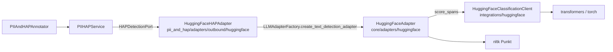

# Design

## Context

See proposal.md (Why) for the motivation and specs/backend/pii-and-hap-operator/spec.md for the required behavior. The current code that shapes the approach:

- **Provider registry.** `PIIAndHAPDetectionFactory` keeps a registry of outbound adapters keyed by `ADAPTER_NAME`. Adapters register through `@register_pii_and_hap_detection_adapter` when `pii_and_hap/adapters/outbound/__init__.py` imports them. Registration checks that the `SUPPORTS_PII` / `SUPPORTS_HAP` flags match the implemented ports, and `validate_selection()` already rejects a HAP-only provider used as `pii_provider`. Nothing in the factory or the annotator needs to change for capability handling.
- **Ports.** `HAPDetectionPort.detect_hap(*, text, threshold) -> PIIHAPDetectionResponse` is the operator-side port. `PresidioPIIAdapter` is the reference single-capability adapter: lazy engine, `validate()` builds the engine (fail-fast), a static `validate_provider_config()` backed by a Pydantic config, and an inference lock.
- **Core text detection.** `core/ports/text_detection_port.py::TextDetectionPort.detect(*, text, detection_types=None, **kwargs) -> dict` has one implementation, `WatsonXAdapter`. In practice the contract is the `detectors` keyword argument, and the result is `{"success", "detections", "error"}` with `success: False` on failure. `WatsonxPIIAndHAPAdapter` wraps it through `LLMAdapterFactory.create_text_detection_adapter()`, which today accepts only `watsonx` and rejects an empty `model_id` or `provider_config`.
- **Existing Hugging Face code.** `core/adapters/huggingface/HuggingFaceAdapter` is a thin `LLMEmbeddingPort` wrapper around `integrations/huggingface/client.py::HuggingFaceLLMClient`, which owns model loading through a class-level cache and lock.
- **Operator concurrency.** `PIIAndHAPAnnotator.transform()` scores documents in a `ThreadPoolExecutor(max_workers=batch_size)`, and micro-batching can run several transforms of the same node at once. A single adapter instance is therefore called from many threads at the same time.
- **Startup.** `PIIHAPService.__init__` calls `adapter.validate()` once per adapter before any document is processed. The annotator builds the service in both execution and flow-validation mode (`validating_flow`).
- **Dependencies.** `torch==2.14.1`, `transformers>=5.17,<5.18` and `nltk==3.10.4` are core dependencies. `nltk.tokenize.punkt.PunktSentenceTokenizer()` with no training data needs no `nltk.download` and returns character spans via `span_tokenize()` (checked in the project venv).

## Goals / Non-Goals

**Goals:**
- Keep each layer to a single job: the operator adapter maps config and results, the core adapter implements `TextDetectionPort` (segmentation, label selection, threshold, result dicts), and the integration client owns `transformers`/`torch`, the model cache and scoring.
- Follow the one-consolidated-adapter-per-provider convention of `docs/guides/UNIFIED_LLM_ARCHITECTURE_GUIDE.md`.
- Make the core `huggingface` text detection usable outside `pii_and_hap` (for example, by a future content-moderation operator) without depending on operator types.
- Keep model-specific knowledge in config and constants. Code never branches on a model name except to apply the default model's default labels.

**Non-Goals:**
- Changing `PIIHAPService`, `PIIAndHAPDetectionFactory`, the annotator's chunking, or the redaction helpers. The annotator changes only in flow validation, where it checks the shared `provider_config` against the provider that falls back to it (D10).
- GPU batching across documents. Spans are batched per call to `detect_hap()` (one chunk of one document), not across documents.
- Changing the `TextDetectionPort` signature or giving it a typed result. This change only documents the existing contract.

## Decisions

### D1. One consolidated `HuggingFaceAdapter` behind `TextDetectionPort`, as for watsonx

`docs/guides/UNIFIED_LLM_ARCHITECTURE_GUIDE.md` sets the convention: each provider has a single consolidated core adapter that implements one or more ports (`WatsonXAdapter` implements three, `LiteLLMAdapter` two). The existing `HuggingFaceAdapter` therefore implements `TextDetectionPort` next to `LLMEmbeddingPort`, rather than a second Hugging Face core adapter class being added. As in `WatsonXAdapter`, each capability's integration client is created lazily, on first use or in its `validate_*` hook, so an adapter built for detection never loads an embedding model and vice versa.

DDD boundaries:
- **Domain** (`pii_and_hap/domain/models.py`): unchanged. `DetectionResult` and `PIIHAPDetectionResponse` carry the results.
- **Ports**: `HAPDetectionPort` (operator outbound) and `TextDetectionPort` (core). Docstrings change only.
- **Application service**: `PIIHAPService`, unchanged. It calls `detect_hap()` only on the HAP port.
- **Adapters**: the new `HuggingFaceHAPAdapter` (operator outbound) depends only on `LLMAdapterFactory` and `TextDetectionPort`, never on `transformers` or a concrete core adapter class (rule 11). `HuggingFaceAdapter` (core) owns the detection semantics and delegates model work to the new `HuggingFaceClassificationClient` (integration).

Because each port defines its own template `validate()`, a class implementing several ports resolves `validate()` by MRO to the first port's hook. `HuggingFaceHAPAdapter` therefore calls `validate_detection()` explicitly, not `validate()`.

*Alternatives considered:*
- A separate `HuggingFaceTextDetectionAdapter` core class. Rejected: it breaks the documented one-adapter-per-provider convention. The only reason for it, the embedding client being built eagerly in `HuggingFaceAdapter.__init__`, is removed by creating clients lazily, as `WatsonXAdapter` already does for embeddings.
- The operator adapter calls `transformers` directly, as Presidio does with `presidio_analyzer`. Rejected: HAP classification should be reachable through `TextDetectionPort` next to the existing `huggingface` embedding provider.

### D2. Detection semantics in the core adapter, model work in an integration client

The split follows one rule: an integration client is named after, and limited to, the external capability it wraps; meaning that belongs to a core port stays in the core adapter.

- `integrations/huggingface/classification_client.py`: `HuggingFaceClassificationClient` wraps Hugging Face sequence classification (the Hub's "text-classification" task). It owns model loading, the process cache (D7), offline and remote-code handling (D8), token windowing (D4) and batched scoring with the activation (D5). Its API is `load()`, `labels`, and `score_spans(text, spans)`, which returns each scored window's offsets and its `{label: probability}` map. It knows nothing about HAP, toxic labels, thresholds or detection result dicts.
- `core/adapters/huggingface/huggingface_adapter.py`: `HuggingFaceAdapter.detect()` splits the text into sentence spans (D3), calls `score_spans`, takes the highest probability among `toxic_labels`, applies the threshold, and builds the `TextDetectionPort` result dicts (D9). `validate_detection()` loads the model and checks that every toxic label exists.

The Hub task gives the file its name (`classification_client.py`), next to the existing embedding `client.py`. By the same rule, a watsonx detection client would be `detection_client.py`, because `/ml/v1/text/detection` is a detection API.

*Alternatives considered:*
- One `text_classification_client.py`/`detection_client.py` holding segmentation, thresholds and detection dicts too. Rejected: it puts core-port meaning in the integration layer, and the model classifies rather than detects.
- A separate, shared `model_registry.py` for all Hugging Face capabilities, and segmentation in a `utils/` module. Rejected for now: each would have a single user. The cache stays private to the classification client and can be extracted when the embedding client moves onto it.

### D3. Segmentation: line breaks, then untrained Punkt, with offsets kept

1. Split the received text on line breaks with a regex, keeping each line's start offset. Docling Markdown has many headings, list items and table rows that have no sentence-final punctuation.
2. Run `PunktSentenceTokenizer().span_tokenize(line)` on each non-blank line and add the line's offset to each span.
3. Trim leading and trailing whitespace from each span by adjusting `start`/`end`, never by changing the text. Drop empty spans.

This satisfies the spec's `text[start:end]` invariant by construction, because the text is never rewritten. `dpk_hap`'s offset loss came from rewriting newlines before splitting.

*Alternatives considered:* `nltk.sent_tokenize` (needs `punkt_tab` data from `nltk.download`, a network call, and returns strings, not spans); spaCy sentencizer (spaCy comes only with the optional Presidio extra); a hand-written sentence regex (more edge cases than untrained Punkt, for no gain). Untrained Punkt splits after abbreviations such as "Dr.", which produces shorter spans. That is acceptable for HAP: every character is still scored, and a split only narrows what gets masked.

### D4. Overlong spans are scored in token windows

Tokenize each span with `return_offsets_mapping=True`. If it has more than `max_length - <special tokens>` tokens, cut it into consecutive, non-overlapping token windows and map each window back to character offsets (first token start to last token end) inside the span. Each window is scored and reported as its own span. This requires a fast tokenizer. A model whose tokenizer is not fast is rejected at startup with an error naming the model. Most current classifiers, including the default and XLM-R based models, ship fast tokenizers.

*Alternative considered:* truncate to `max_length` and score the head only. Rejected because toxic text at the end of a long run-on line or table row would go undetected. Overlapping windows (with a stride) were also rejected: they would double-count detections in the `hap` column.

`max_length` defaults to 512 and is capped at the tokenizer's `model_max_length`.

Windows are scored from the span's original token IDs, with the model's special tokens added around them, and are never re-tokenized from their text. Re-tokenizing text that starts inside a word can produce more tokens than were counted (for example WordPiece splits `thoughtlessness` into `thought` + `##lessness`, but `lessness` on its own into `less` + `##ness`); truncation would then drop the window's last tokens without scoring them. The special-token prefix and suffix are learned when the client loads the model, by encoding a probe string with and without special tokens, because recent `transformers` versions no longer expose `build_inputs_with_special_tokens` on fast tokenizers. A tokenizer whose special tokens are not a fixed prefix and suffix is rejected at startup with an error naming the model.

Cuts fall at word starts: a token may begin a window only when whitespace separates it from the previous token. A cut that would land inside a word moves back to that word's first token, so words stay whole (the model never starts on a word fragment, and redaction masks whole words). Only a single word longer than the whole window budget is split.

### D5. Scoring

- Order spans by token length, to reduce padding, then run them in batches of `batch_size` (default 32), each padded to its longest window with an attention mask, under `torch.inference_mode()`, in `model.eval()` mode. Restore the original order before returning.
- `activation`: `softmax`, `sigmoid`, or `auto`. `auto` uses sigmoid when `model.config.problem_type == "multi_label_classification"` and softmax otherwise. The default model uses softmax. The client applies it and returns probabilities for every label.
- The adapter checks `toxic_labels` against the client's `labels` (the model's `id2label` values) in `validate_detection()`. Any name not found is a startup error that lists the available labels. The span score is the highest probability among the toxic labels, and the best label is kept for evidence.
- The adapter reports a span when `score >= threshold`.

### D6. Labels and defaults

Constants in `core/constants/constants.py` (`ServiceConstants`): `DEFAULT_HUGGINGFACE_HAP_MODEL_ID = "ibm-granite/granite-guardian-hap-38m"`, `DEFAULT_HUGGINGFACE_HAP_REVISION = "faf9291163c7363d4a7ba7fc1dc72243214af931"` (the Hub head commit, last modified 2024-12-19), `DEFAULT_HUGGINGFACE_HAP_TOXIC_LABELS = ("LABEL_1",)`, `DEFAULT_HUGGINGFACE_HAP_MAX_LENGTH = 512`, `DEFAULT_HUGGINGFACE_HAP_BATCH_SIZE = 32`, `DEFAULT_HUGGINGFACE_HAP_THRESHOLD = 0.8`. Default resolution happens in one place, the operator-side Pydantic `HuggingFaceHAPConfig` (D10), because choosing a default HAP classifier is HAP policy, owned by the `pii_and_hap` operator:
- `model_id` defaults to the default model;
- a missing `revision` becomes the pinned default revision only when the model is the default model; for any other model it stays unset (the Hub's default branch);
- missing `toxic_labels` become the default labels only when the model is the default model; otherwise validation fails.

`HuggingFaceHAPAdapter` validates `hap_provider_config` with this model and passes the resolved values to `LLMAdapterFactory`, whose `huggingface` branch and `HuggingFaceAdapter` hold no HAP defaults (D11). Because the defaults are field defaults and validator output, `get_config_schema()` publishes them in operator metadata, so the properties panel shows the effective values, and flow validation reports every rule statically without loading a model.

The default model id, revision and toxic labels form one unit: changing the default model means updating all three together, in a release whose notes state that flows relying on an empty `hap_provider_config` will score differently.

*Why pin the default revision:* if the default model's weights are replaced in place on its default branch, an unpinned default would change scores silently on the next fresh download. Pinning keeps the default reproducible across machines and over time. The cost is that upstream fixes reach users only when the constant is bumped. If the repository is deleted or gated, pinning does not help, but startup fails loudly (D8).

The error message for a missing `toxic_labels` on a non-default model SHALL include a hint directing the user to the model's `id2label` field (e.g. `"Check the model's config.json id2label on Hugging Face for available label names."`), so users do not need to discover this manually.

*Alternatives considered:*
- Always default `toxic_labels` to `LABEL_1`. Rejected because for many models `LABEL_1` is not the toxic class, or does not exist, and the model would silently score the wrong class.
- Resolve defaults in `LLMAdapterFactory`, or in a `HuggingFaceAdapter` classmethod. Rejected: both put HAP policy in the core layer, which also serves embeddings, and the operator config would need a second copy of the `toxic_labels` rule for flow validation.

### D7. Process-wide model cache and per-model inference lock

`HuggingFaceClassificationClient` holds a class-level `dict[(model_id, revision, device), _LoadedModel]`, protected by a load lock with double-checked locking, following `HuggingFaceLLMClient` and `FastTextModelManager`. `_LoadedModel` holds the tokenizer, the model and an inference `threading.Lock`.

- **Device resolution** happens before the cache lookup. `None`/`"auto"` resolves to `cuda` when available and `cpu` otherwise. `mps` is used only when requested explicitly, because of operator coverage gaps. The cache key uses the resolved device.
- **Failed loads are not cached**, so a later run can retry after the user fixes connectivity or the cache.
- **Inference is serialized per model.** Hugging Face fast tokenizers raise `RuntimeError: Already borrowed` when one instance is used from several threads, and the operator calls the adapter from a thread pool. The lock covers tokenization and the forward pass. Throughput comes from batching spans and from torch's own intra-op threads, not from Python threads.
- Models are never unloaded. A 38M-parameter model is about 150 MB in fp32, and docpipe processes are long-lived. Reference counting (as in `FastTextModelManager`) adds complexity without a current need.

*Alternative considered:* one model per adapter instance. Rejected: micro-batching would load one copy per batch, which violates the spec's per-process sharing requirement.

### D8. Loading, offline mode and remote code

- `transformers`, `torch` and `nltk.tokenize.punkt` are imported inside methods, never at module import, in both the client and `HuggingFaceAdapter`. Operator-registry import stays cheap and does no network I/O.
- `AutoTokenizer.from_pretrained` and `AutoModelForSequenceClassification.from_pretrained` receive `revision`, `local_files_only`, and `trust_remote_code=False` always. `HF_HUB_OFFLINE=1` is honored natively by `huggingface_hub`. When loading fails and offline mode is on (either source), the error says that offline mode is enabled and names the model.
- When the default model fails to load, the error also says that another classifier can be used by setting `model_id` and `toxic_labels` in `hap_provider_config`, so users have a way forward if the default repository becomes unavailable before a release changes the default. `HuggingFaceAdapter` passes this hint to the client only for the default model; the client appends whatever hint it is given.
- Loading happens in `HuggingFaceAdapter.validate_detection()`, which `HuggingFaceHAPAdapter.validate()` calls and `PIIHAPService` runs at startup. This matches Presidio. Load and label errors become `{"valid": False, "errors": [...]}`, which the service turns into a `DocpipeException` before any document is processed.

### D9. Error and logging contract

- `HuggingFaceAdapter.detect()` never raises for scoring errors. It returns `{"success": False, "detections": [], "error": "<ExceptionClass> while scoring with model '<model_id>'"}`. The exception message is left out because tokenizer and torch errors can echo input. `WatsonxPIIAndHAPAdapter` already raises `DocpipeException` on `success: False`, and the HF operator adapter does the same, so the annotator records the document as failed through its existing per-document failure path.
- Startup errors may include the exception message, since no document text is involved at load time.
- `detectors` is the request contract. The HAP threshold comes from `detectors["hap"]["threshold"]` (default 0.8). Any other requested detector key, or a `detection_types` value other than `["hap"]`, returns `success: False` with an "unsupported detector" error.
- Logs: INFO on model load (model id, revision, device, load seconds). DEBUG per call (span count, flagged count, elapsed ms). All logs use `%s` formatting and ASCII only, and never include text, spans or tokens. Detection `text` fields are returned to the caller, as Presidio does, but never logged.

### D10. Operator outbound adapter

`pii_and_hap/adapters/outbound/huggingface/`:
- `config.py`: `ADAPTER_NAME = "huggingface"` and the `HuggingFaceHAPConfig` Pydantic model with `extra="forbid"`. Fields: `model_id`, `revision`, `toxic_labels`, `activation` (`Literal`), `max_length` and `batch_size` (positive ints), `device` (`Literal["auto", "cpu", "cuda", "mps"] | None`), and `local_files_only` (bool, default false). Each field has a description, because `get_config_schema()` feeds the properties panel through operator metadata.
- Unknown keys are rejected rather than ignored. Every field changes behavior when a misspelling is dropped silently: a misspelled `local_files_only` downloads from the Hub although the user asked for offline operation, and a misspelled `revision` runs an unpinned model. The check is static (flow validation, no model load). The properties panel resets `provider_config` when the provider changes and seeds defaults only from the selected provider's schema, so it sends no foreign keys. The one flow shape that now fails is the legacy shared `provider_config` serving two different providers; the error names the unknown keys, lists the accepted ones and suggests `hap_provider_config`. Other providers' configs keep their current policy in this change.
- One owner per concern. Unknown keys are reported by the existing metadata-driven check, `validate_config_from_metadata` in `utils/operators/config_validation.py`, which already rejects keys outside a provider's published schema when that schema forbids extra keys, with the same message in every operator. `HuggingFaceHAPAdapter.validate_provider_config` therefore reports only value errors. The generic check finds a config's provider from the sibling `*_provider` field or `provider`, so it cannot see which provider the shared `provider_config` belongs to when `provider` is unset and a capability provider falls back to it. The annotator's `_validate_provider_configs`, which already holds the fallback rules, closes that gap: for a selection whose config is the shared `provider_config` while `provider` is unset, it runs the same key check against that provider's schema and adds the `<capability>_provider_config` hint. This applies to any provider with a strict schema, not only `huggingface`.
- `adapter.py`: `HuggingFaceHAPAdapter(HAPDetectionPort)` with `ADAPTER_DISPLAY_NAME = "Hugging Face (HAP only)"`, `SUPPORTS_PII = False`, `SUPPORTS_HAP = True` and `REQUIRES_MODEL_ID = False`. `validate_provider_config` is a static Pydantic check (no model load). `validate()` returns config errors first, then calls the core adapter's `validate_detection()` (D1). `detect_hap()` calls `detect(text=..., detectors={"hap": {"threshold": t}})` and maps the dicts with `convert_detection_dicts_to_results`.
- Registered in `adapters/outbound/__init__.py` next to the other adapters.

### D11. Factory change

`LLMAdapterFactory.TEXT_DETECTION_PROVIDERS` becomes `{"watsonx", "huggingface"}`. The `model_id` and `provider_config` non-empty checks move inside the `watsonx` path, so watsonx error messages stay the same. The `huggingface` branch requires a non-empty `model_id` and `provider_config["toxic_labels"]` (raising `ValueError` otherwise), maps the remaining keys onto `HuggingFaceAdapter` arguments, and returns it configured for detection. It resolves no HAP defaults (D6); `batch_size` and `max_length` still go through the existing `_positive_int_option` helper, which falls back to the `ServiceConstants` values for direct callers that omit them. Dispatch stays `if`/`elif`, like the factory's other providers and capabilities. `get_supported_providers(capability="text_detection")` reflects the new set automatically. The embedding branch keeps its current arguments.

### D12. Lazy embedding client in `HuggingFaceAdapter`

`HuggingFaceAdapter.__init__` stops building `HuggingFaceLLMClient`. It stores the embedding options, and the client is built on first use of an embedding method or in a new `validate_embedding()` override. The embeddings operator calls `adapter.validate()` before processing, which resolves to `validate_embedding()` because `LLMEmbeddingPort` is the adapter's first base, so a bad embedding model still fails at startup. Embedding behavior and the factory's embedding arguments are otherwise unchanged. As in `WatsonXAdapter`, `model_name` names the model of the capability the adapter is built for: the embedding model, or the classifier for text detection. The constructor becomes keyword-only (rule 5).

## Risks / Trade-offs

- **[Chunk-relative offsets for multi-chunk documents]** `_perform_detections_for_single_document` splits large documents (default min/max chunk sizes in the 50-100 KB range) with `split_text_into_chunks`, which strips and re-joins paragraphs. The adapter's offsets are correct for the chunk it receives, but they appear to be applied to the full document during redaction. This likely affects every provider from the second chunk onward, and it is not yet confirmed by a failing test. → This change specifies offsets relative to the received text, and its redaction scenario covers single-chunk documents. The fix is a separate task. The README states the limitation until it lands.
- **[Model loads during flow validation]** The annotator builds `PIIHAPService` in `validating_flow` mode too, so `POST /api/v1/validation/validate_flow` loads, and on first use downloads, the model in the API process, as Presidio already does with spaCy. → The model is cached per process, so a later run in the same process pays nothing. Moving dependency-heavy checks out of flow validation for all providers is a possible follow-up, outside this change's scope.
- **[Serialized inference limits thread-level parallelism]** → Spans are batched inside each call, and torch parallelizes across cores itself. On GPU, kernels run in order anyway. This can be revisited with a tokenizer-per-thread pool if profiling shows contention.
- **[Embedding errors move from construction to validation]** With the lazy embedding client (D12), a bad embedding model no longer fails in `HuggingFaceAdapter.__init__`. → `validate_embedding()` builds the client, and the embeddings operator already calls `validate()` before processing. Code that constructs the adapter and calls an embedding method directly gets the same error on that first call.
- **[Over-splitting by untrained Punkt]** → Shorter spans still cover all text. Users who need coarser masking can rely on the `hap` count instead of redaction. Trained Punkt data can be added later as an option without a spec change.
- **[Granite HAP 38M is English-only]** → Documented. Multilingual coverage comes from configuring a multilingual `model_id`, and the README notes the license review needed for OpenRAIL++ models.
- **[First run needs network]** → Documented offline workflow: pre-fetch with `huggingface-cli download <model> --revision <rev>`, then set `local_files_only: true` or `HF_HUB_OFFLINE=1`.
- **[Memory per distinct model/revision/device]** → Each key loads once. The README notes that every distinct configuration keeps its own copy for the process lifetime.
- **[Default model deprecated or removed]** → The default model is pinned to a commit (D6), so in-place weight changes do not affect it. If the repository is deleted or gated, startup fails with an error naming the model and pointing to `model_id`/`toxic_labels` (D8); hosts with cached weights keep working offline. Replacing the default is a release-level change to the D6 constants.
- **[Unpinned revision for non-default models]** → `revision` defaults to the Hub's default branch for any model other than the default. The docs recommend pinning `model_id` and `revision` in production flows.
- **[Toxic phrase dilution in long sentences]** A sequence-classification model scores the entire span as one unit. A short toxic phrase embedded in a long neutral sentence (e.g. a 200-word business sentence containing a 5-word slur) will have its score diluted by the surrounding clean context and may fall below `hap_threshold`. D3 mitigates this by splitting at sentence boundaries first, but cannot split *within* a sentence. → Users who need higher recall can lower `hap_threshold` at the cost of more false positives. Phrase-level detection would require a token-classification model — a different architecture and a non-goal of this change. The README documents this as a known limitation.

## Migration Plan

This change only adds behavior: no config, schema or default changes for existing flows, and no data migration. To roll back, revert the change. Flows that use `hap_provider: "huggingface"` would then fail validation with the existing unknown-provider error.

## Open Questions

None. The default revision question is resolved in D6: the default model is pinned to commit `faf9291163c7363d4a7ba7fc1dc72243214af931`.
