# Design

## Context

See proposal.md (Why) for the motivation and specs/backend/pii-and-hap-operator/spec.md for the required behavior. The current code that shapes the approach:

- **Provider registry.** `PIIAndHAPDetectionFactory` keeps a registry of outbound adapters keyed by `ADAPTER_NAME`. Adapters register through `@register_pii_and_hap_detection_adapter` when `pii_and_hap/adapters/outbound/__init__.py` imports them. Registration checks that the `SUPPORTS_PII` / `SUPPORTS_HAP` flags match the implemented ports, and `validate_selection()` already rejects a HAP-only provider used as `pii_provider`. Nothing in the factory or the annotator needs to change for capability handling.
- **Ports.** `HAPDetectionPort.detect_hap(*, text, threshold) -> PIIHAPDetectionResponse` is the operator-side port. `PresidioPIIAdapter` is the reference single-capability adapter: lazy engine, `validate()` builds the engine (fail-fast), a static `validate_provider_config()` backed by a Pydantic config, and an inference lock.
- **Core text detection.** `core/ports/text_detection_port.py::TextDetectionPort.detect(*, text, detection_types=None, **kwargs) -> dict` has one implementation, `WatsonXAdapter`. In practice the contract is the `detectors` keyword argument, and the result is `{"success", "detections", "error"}` with `success: False` on failure. `WatsonxPIIAndHAPAdapter` wraps it through `LLMAdapterFactory.create_text_detection_adapter()`, which today accepts only `watsonx` and rejects an empty `model_id` or `provider_config`.
- **Existing Hugging Face code.** `core/adapters/huggingface/HuggingFaceAdapter` is a thin `LLMEmbeddingPort` wrapper around `integrations/huggingface/client.py::HuggingFaceLLMClient`, which owns model loading through a class-level cache and lock.
- **Operator concurrency.** `PIIAndHAPAnnotator.transform()` scores documents in a `ThreadPoolExecutor(max_workers=batch_size)`, and micro-batching can run several transforms of the same node at once. A single adapter instance is therefore called from many threads at the same time.
- **Startup.** `PIIHAPService.__init__` calls `adapter.validate()` once per adapter before any document is processed. The annotator builds the service in both execution and flow-validation mode (`validating_flow`).
- **Dependencies.** `torch==2.14.1`, `transformers>=5.17,<5.18` and `nltk==3.10.4` are core dependencies. `nltk.tokenize.punkt.PunktSentenceTokenizer()` with no training data needs no `nltk.download` and returns character spans via `span_tokenize()` (checked in the project venv).

## Goals / Non-Goals

**Goals:**
- Keep each layer to a single job: the operator adapter maps config and results, the core adapter implements `TextDetectionPort`, and the integration client owns `transformers`/`torch` and the model cache.
- Make the core `huggingface` text detection usable outside `pii_and_hap` (for example, by a future content-moderation operator) without depending on operator types.
- Keep model-specific knowledge in config and constants. Code never branches on a model name except to apply the default model's default labels.

**Non-Goals:**
- Changing `PIIHAPService`, `PIIAndHAPDetectionFactory`, the annotator's chunking, or the redaction helpers.
- GPU batching across documents. Spans are batched per call to `detect_hap()` (one chunk of one document), not across documents.
- Changing the `TextDetectionPort` signature or giving it a typed result. This change only documents the existing contract.

## Decisions

### D1. Two layers behind `TextDetectionPort`, mirroring watsonx

```mermaid
graph LR
    A[PIIAndHAPAnnotator] --> B[PIIHAPService]
    B -->|HAPDetectionPort| C[HuggingFaceHAPAdapter<br/>pii_and_hap/adapters/outbound/huggingface]
    C -->|LLMAdapterFactory.create_text_detection_adapter| D[HuggingFaceTextDetectionAdapter<br/>core/adapters/huggingface]
    D -->|TextDetectionPort| E[HuggingFaceTextClassificationClient<br/>integrations/huggingface]
    E --> F[transformers / torch / nltk]
```

DDD boundaries:
- **Domain** (`pii_and_hap/domain/models.py`): unchanged. `DetectionResult` and `PIIHAPDetectionResponse` carry the results.
- **Ports**: `HAPDetectionPort` (operator outbound) and `TextDetectionPort` (core). Docstrings change only.
- **Application service**: `PIIHAPService`, unchanged. It calls `detect_hap()` only on the HAP port.
- **Adapters**: the new `HuggingFaceHAPAdapter` (operator outbound) depends only on `LLMAdapterFactory` and `TextDetectionPort`, never on `transformers` or a concrete core adapter class (rule 11). The new `HuggingFaceTextDetectionAdapter` (core) delegates to the new `HuggingFaceTextClassificationClient` (integration).

*Alternative considered:* the operator adapter calls `transformers` directly, as Presidio does with `presidio_analyzer`. Rejected: the handoff and issue want HAP classification reachable through `TextDetectionPort` next to the existing `huggingface` embedding provider, and the watsonx adapter already sets the two-layer pattern for detection.

### D2. Model code lives in `integrations/huggingface/`

`integrations/huggingface/text_classification_client.py` holds model loading, the process cache, segmentation, windowing and scoring. `core/adapters/huggingface/huggingface_text_detection_adapter.py` maps the `TextDetectionPort` call shape (detectors, result dict, error handling) onto it. This matches the embedding path, `HuggingFaceAdapter` -> `HuggingFaceLLMClient`.

*Alternative considered:* keep everything in `core/adapters/huggingface/`, as the handoff sketched. Rejected only for consistency with the existing Hugging Face split; the behavior is the same either way.

### D3. Segmentation: line breaks, then untrained Punkt, with offsets kept

1. Split the received text on line breaks with a regex, keeping each line's start offset. Docling Markdown has many headings, list items and table rows that have no sentence-final punctuation.
2. Run `PunktSentenceTokenizer().span_tokenize(line)` on each non-blank line and add the line's offset to each span.
3. Trim leading and trailing whitespace from each span by adjusting `start`/`end`, never by changing the text. Drop empty spans.

This satisfies the spec's `text[start:end]` invariant by construction, because the text is never rewritten. `dpk_hap`'s offset loss came from rewriting newlines before splitting.

*Alternatives considered:* `nltk.sent_tokenize` (needs `punkt_tab` data from `nltk.download`, a network call, and returns strings, not spans); spaCy sentencizer (spaCy comes only with the optional Presidio extra); a hand-written sentence regex (more edge cases than untrained Punkt, for no gain). Untrained Punkt splits after abbreviations such as "Dr.", which produces shorter spans. That is acceptable for HAP: every character is still scored, and a split only narrows what gets masked.

### D4. Overlong spans are scored in token windows

Tokenize each span with `return_offsets_mapping=True`. If it has more than `max_length - <special tokens>` tokens, cut it into consecutive, non-overlapping token windows and map each window back to character offsets (first token start to last token end) inside the span. Each window is scored and reported as its own span. This requires a fast tokenizer. A model whose tokenizer is not fast is rejected at startup with an error naming the model. Most current classifiers, including the default and XLM-R based models, ship fast tokenizers.

*Alternative considered:* truncate to `max_length` and score the head only. Rejected because toxic text at the end of a long run-on line or table row would go undetected. Overlapping windows (with a stride) were also rejected: they would double-count detections in the `hap` column.

`max_length` defaults to 512 and is capped at the tokenizer's `model_max_length`.

### D5. Scoring

- Order spans by token length, to reduce padding, then run them in batches of `batch_size` (default 32) with `padding="longest"`, under `torch.inference_mode()`, in `model.eval()` mode. Restore the original order before returning.
- `activation`: `softmax`, `sigmoid`, or `auto`. `auto` uses sigmoid when `model.config.problem_type == "multi_label_classification"` and softmax otherwise. The default model uses softmax.
- Resolve `toxic_labels` to class indices once, at load time, through `model.config.label2id`. Any name not found is a startup error that lists `id2label` values. The span score is the highest probability among those indices. The best label is kept for evidence.
- Report a span when `score >= threshold`.

### D6. Labels and defaults

Constants in `core/constants/constants.py` (`ServiceConstants`): `DEFAULT_HUGGINGFACE_HAP_MODEL_ID = "ibm-granite/granite-guardian-hap-38m"`, `DEFAULT_HUGGINGFACE_HAP_TOXIC_LABELS = ("LABEL_1",)`, `DEFAULT_HUGGINGFACE_HAP_MAX_LENGTH = 512`, `DEFAULT_HUGGINGFACE_HAP_BATCH_SIZE = 32`. Default resolution happens in one place, the `huggingface` branch of `LLMAdapterFactory.create_text_detection_adapter`:
- an empty `model_id` becomes the default model;
- missing `toxic_labels` become the default labels only when the resolved model is the default model; otherwise the factory raises `ValueError`.

The operator-side Pydantic `HuggingFaceHAPConfig` (with `extra="ignore"`, like Presidio's) applies the same `toxic_labels` rule in a model validator, so flow validation reports it statically. It uses the same constants, so the two checks cannot drift apart. The error message for a missing `toxic_labels` on a non-default model SHALL include a hint directing the user to the model's `id2label` field (e.g. `"Check the model's config.json id2label on Hugging Face for available label names."`), so users do not need to discover this manually.

*Alternative considered:* always default `toxic_labels` to `LABEL_1`. Rejected because for many models `LABEL_1` is not the toxic class, or does not exist, and the model would silently score the wrong class.

### D7. Process-wide model cache and per-model inference lock

`HuggingFaceTextClassificationClient` holds a class-level `dict[(model_id, revision, device), _LoadedModel]`, protected by a load lock with double-checked locking, following `HuggingFaceLLMClient` and `FastTextModelManager`. `_LoadedModel` holds the tokenizer, the model, the resolved label indices for each `toxic_labels` tuple, and an inference `threading.Lock`.

- **Device resolution** happens before the cache lookup. `None`/`"auto"` resolves to `cuda` when available and `cpu` otherwise. `mps` is used only when requested explicitly, because of operator coverage gaps. The cache key uses the resolved device.
- **Failed loads are not cached**, so a later run can retry after the user fixes connectivity or the cache.
- **Inference is serialized per model.** Hugging Face fast tokenizers raise `RuntimeError: Already borrowed` when one instance is used from several threads, and the operator calls the adapter from a thread pool. The lock covers tokenization and the forward pass. Throughput comes from batching spans and from torch's own intra-op threads, not from Python threads.
- Models are never unloaded. A 38M-parameter model is about 150 MB in fp32, and docpipe processes are long-lived. Reference counting (as in `FastTextModelManager`) adds complexity without a current need.

*Alternative considered:* one model per adapter instance. Rejected: micro-batching would load one copy per batch, which violates the spec's per-process sharing requirement.

### D8. Loading, offline mode and remote code

- `transformers`, `torch` and `nltk.tokenize.punkt` are imported inside client methods, never at module import. Operator-registry import stays cheap and does no network I/O.
- `AutoTokenizer.from_pretrained` and `AutoModelForSequenceClassification.from_pretrained` receive `revision`, `local_files_only`, and `trust_remote_code=False` always. `HF_HUB_OFFLINE=1` is honored natively by `huggingface_hub`. When loading fails and offline mode is on (either source), the error says that offline mode is enabled and names the model.
- Loading happens in `validate()` of the core adapter, which `HuggingFaceHAPAdapter.validate()` calls and `PIIHAPService` runs at startup. This matches Presidio. Load and label errors become `{"valid": False, "errors": [...]}`, which the service turns into a `DocpipeException` before any document is processed.

### D9. Error and logging contract

- `HuggingFaceTextDetectionAdapter.detect()` never raises for scoring errors. It returns `{"success": False, "detections": [], "error": "<ExceptionClass> while scoring with model '<model_id>'"}`. The exception message is left out because tokenizer and torch errors can echo input. `WatsonxPIIAndHAPAdapter` already raises `DocpipeException` on `success: False`, and the HF operator adapter does the same, so the annotator records the document as failed through its existing per-document failure path.
- Startup errors may include the exception message, since no document text is involved at load time.
- `detectors` is the request contract. The HAP threshold comes from `detectors["hap"]["threshold"]` (default 0.8). Any other requested detector key, or a `detection_types` value other than `["hap"]`, returns `success: False` with an "unsupported detector" error.
- Logs: INFO on model load (model id, revision, device, load seconds). DEBUG per call (span count, flagged count, elapsed ms). All logs use `%s` formatting and ASCII only, and never include text, spans or tokens. Detection `text` fields are returned to the caller, as Presidio does, but never logged.

### D10. Operator outbound adapter

`pii_and_hap/adapters/outbound/huggingface/`:
- `config.py`: `ADAPTER_NAME = "huggingface"` and the `HuggingFaceHAPConfig` Pydantic model. Fields: `model_id`, `revision`, `toxic_labels`, `activation` (`Literal`), `max_length` and `batch_size` (positive ints), `device` (`Literal["auto", "cpu", "cuda", "mps"] | None`), and `local_files_only` (bool, default false). Each field has a description, because `get_config_schema()` feeds the properties panel through operator metadata.
- `adapter.py`: `HuggingFaceHAPAdapter(HAPDetectionPort)` with `ADAPTER_DISPLAY_NAME = "Hugging Face (HAP only)"`, `SUPPORTS_PII = False`, `SUPPORTS_HAP = True` and `REQUIRES_MODEL_ID = False`. `validate_provider_config` is a static Pydantic check (no model load). `validate()` returns config errors first, then delegates to the core adapter. `detect_hap()` calls `detect(text=..., detectors={"hap": {"threshold": t}})` and maps the dicts with `convert_detection_dicts_to_results`.
- Registered in `adapters/outbound/__init__.py` next to the other adapters.

### D11. Factory change

`LLMAdapterFactory.TEXT_DETECTION_PROVIDERS` becomes `{"watsonx", "huggingface"}`. The `model_id` and `provider_config` non-empty checks move inside the `watsonx` path, so watsonx error messages stay the same. The `huggingface` branch reads options with the existing `_positive_int_option` helper for `batch_size` and `max_length`, resolves defaults (D6), and returns `HuggingFaceTextDetectionAdapter`. `get_supported_providers(capability="text_detection")` reflects the new set automatically.

## Risks / Trade-offs

- **[Chunk-relative offsets for multi-chunk documents]** `_perform_detections_for_single_document` splits large documents (default min/max chunk sizes in the 50-100 KB range) with `split_text_into_chunks`, which strips and re-joins paragraphs. The adapter's offsets are correct for the chunk it receives, but they appear to be applied to the full document during redaction. This likely affects every provider from the second chunk onward, and it is not yet confirmed by a failing test. → This change specifies offsets relative to the received text, and its redaction scenario covers single-chunk documents. The fix is a separate task. The README states the limitation until it lands.
- **[Model loads during flow validation]** The annotator builds `PIIHAPService` in `validating_flow` mode too, so `POST /api/v1/validation/validate_flow` loads, and on first use downloads, the model in the API process, as Presidio already does with spaCy. → The model is cached per process, so a later run in the same process pays nothing. Moving dependency-heavy checks out of flow validation for all providers is a possible follow-up, outside this change's scope.
- **[Serialized inference limits thread-level parallelism]** → Spans are batched inside each call, and torch parallelizes across cores itself. On GPU, kernels run in order anyway. This can be revisited with a tokenizer-per-thread pool if profiling shows contention.
- **[Over-splitting by untrained Punkt]** → Shorter spans still cover all text. Users who need coarser masking can rely on the `hap` count instead of redaction. Trained Punkt data can be added later as an option without a spec change.
- **[Granite HAP 38M is English-only]** → Documented. Multilingual coverage comes from configuring a multilingual `model_id`, and the README notes the license review needed for OpenRAIL++ models.
- **[First run needs network]** → Documented offline workflow: pre-fetch with `huggingface-cli download <model> --revision <rev>`, then set `local_files_only: true` or `HF_HUB_OFFLINE=1`.
- **[Memory per distinct model/revision/device]** → Each key loads once. The README notes that every distinct configuration keeps its own copy for the process lifetime.
- **[Unpinned default revision]** → `revision` defaults to the Hub's default branch. The docs recommend pinning a commit for reproducible scores.
- **[Toxic phrase dilution in long sentences]** A sequence-classification model scores the entire span as one unit. A short toxic phrase embedded in a long neutral sentence (e.g. a 200-word business sentence containing a 5-word slur) will have its score diluted by the surrounding clean context and may fall below `hap_threshold`. D3 mitigates this by splitting at sentence boundaries first, but cannot split *within* a sentence. → Users who need higher recall can lower `hap_threshold` at the cost of more false positives. Phrase-level detection would require a token-classification model — a different architecture and a non-goal of this change. The README documents this as a known limitation.

## Migration Plan

This change only adds behavior: no config, schema or default changes for existing flows, and no data migration. To roll back, revert the change. Flows that use `hap_provider: "huggingface"` would then fail validation with the existing unknown-provider error.

## Open Questions

- Should the default `revision` be pinned to a specific commit of `ibm-granite/granite-guardian-hap-38m` in `ServiceConstants`? This can be decided during implementation without changing the specs, the approach or the tasks.
