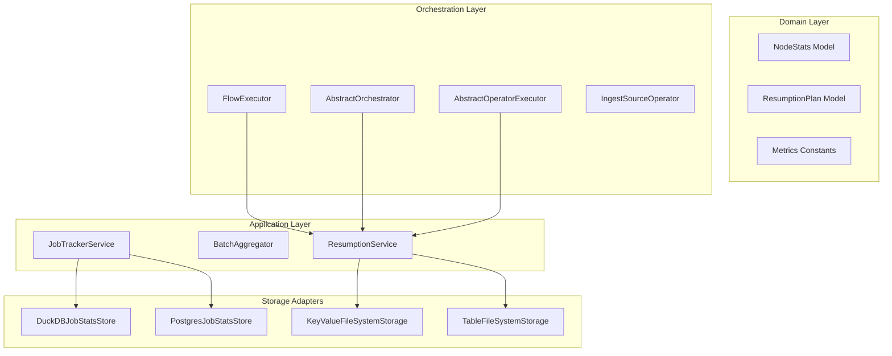

# Design: Node-Level Failure Resumption with Deferred Execution Tracking

## Context

See `proposal.md` for motivation. In Docling Pipelines, pipeline execution produces intermediate Parquet files per operator when configured with local or object data access (`DocpipeDataAccessLocal`). Document status and failure details per node are captured in `JobStatsStore`, but only as per-run document IDs (`NodeStats.failed_docs: list[str]`), and every run has its own rows. Neither the source `modification_time` nor a failure count that spans runs is available there. On subsequent incremental executions, all un-finalized documents are evaluated from the root Ingest operator.

This design introduces a pre-execution **Resumption Planner** that identifies failed documents whose upstream node output is stored, tracks them as `deferred_execution_docs` through upstream nodes, and injects the stored rows directly at every node where they failed. No checkpoint copy is written: the rows are read from the intermediate node output that the executors already persist when `data_storage_type` is not `memory`.

### Where the failure state is stored

The stale-file check and the `max_retry_attempts` limit need values that must outlive a single job run. They are **not** read from `JobStatsStore` or `IncrementalMetadataStore`:

| Value | Stored in | Model / field | Scope |
|---|---|---|---|
| Source `modification_time` at failure | `ResumptionRecord` | `ResumptionRecord.modified_time` (taken from the failed input row's `modified_time`; `None` when absent) | per document |
| Consecutive failure count | `ResumptionRecord` | `FailedNode.failure_count` | per document and failed node |
| `exhausted` flag | `ResumptionRecord` | `FailedNode.exhausted` (`failure_count > max_retry_attempts`) | per document and failed node |
| Original error | `ResumptionRecord` | `FailedNode.error_message` | per document and failed node |

`ResumptionRecord` is persisted through `KeyValueStoragePort` (adapter `KeyValueFileSystemStorage`) as one JSON file per document: `<data path>/<job_id>/resumption/<sha256(doc_id)>.json`. The collection is keyed by `job_id` only, never by `job_run_id`, so the failure count accumulates across runs while each run still has its own `NodeStats` rows. `ResumptionService.record_failure` reads the existing record, increments the node's `failure_count` and writes it back.

Why not the existing stores:

- `NodeStats.failed_docs` holds IDs only, and `NodeStats` rows belong to one run, so neither a time stamp nor a cross-run count fits there without a new per-document table.
- `IncrementalMetadataStore` has `modified_time`, but recoverable failed documents are removed from it (`incremental_update_service.py`), so it is not a source for failures. It is used only to persist retry-exhausted documents as non-recoverable.

**Stale-file check.** At ingest, `ResumptionService.classify` compares the source's current `modified_time` with `ResumptionRecord.modified_time`. If the source is strictly newer, the record is deleted and the document is ingested fresh from the first operator; otherwise it is deferred. The check is skipped (document stays deferred) when either value is unknown.

### Where the earlier run's output is found

Each run has its own `job_run_id`, so a later run cannot derive the location of an earlier run's output by itself. The failure record therefore stores what is needed to derive it, and nothing else (no path):

| Needed to locate the output | Source |
|---|---|
| `job_id` | Same job; the key of the failure records (`<job_id>/resumption`) |
| `job_run_id` | `FailedNode.job_run_id`, copied to `DeferredRecord.job_run_id` |
| `batch_num` | `FailedNode.batch_num`, copied to `DeferredRecord.batch_num`; `None` when the failed run was not micro-batched |
| predecessor node name and output index | Resolved from the current flow by `ResumptionService.build_plan` (`source_node_name`, `source_output_index`) |

The executors save the output of every node and output index to the folder written by `DataAccessUtils.add_node_name_to_output_folder` (`src/docpipe/core/data_access/data_access_utils.py`):

```text
<data path>/<job_id>/<job_run_id>/data/<node name>_<output index>[/<batch_num>]/output.parquet
```

`<node name>` is sanitized with `re.sub(r"\W+", "_", ...)` and `/<batch_num>` is present only when the run was micro-batched (`BATCH_NUM` is set by the orchestrator only in micro-batch mode). The resumption factory (`resumption_factory.py`) builds exactly this relative table name from the four values above, so the layout is shared by writer and reader through the same naming rule and no folder is searched for.

**Batch layout.** Micro-batching is enabled by default and a batch number is only meaningful inside the run that created it: the same document can land in batch 3 in one run and batch 0 in the next. The failed run's `batch_num` is therefore recorded when the failure is recorded (`AbstractOperatorExecutor` reads `BATCH_NUM` from its params) and is used as is when resuming. The current run's batch assignment is irrelevant for reading: the resumed rows are read from `<failed run>/<failed batch>` and appended to whichever current batch the planner assigns to the document (`build_plan` keeps all entries of one document in the same current batch).

**Memory storage.** When `data_storage_type` is `memory`, `DataAccessUtils.add_intermediate_storage_config` configures `DataAccessMemory`: no Parquet files are created, so there is no earlier output to read. Resumption therefore requires `data_storage_type` to be set and not `memory` (`is_resumption_enabled`). When it is `memory` or unset, `create_resumption_service` returns `None`: no failure record is written, no document is deferred, and failed documents are re-ingested from the root as before. Nothing is silently lost: the feature degrades to the existing behavior.

## Goals / Non-Goals

**Goals:**
- Provide automated resumption of previously failed documents at their point of failure during standard incremental runs.
- Maintain mathematical consistency across node-level metrics: $\text{documents\_in\_scope} = \text{processed} + \text{deferred} + \text{failed} + \text{skipped}$.
- Validate source file timestamps against saved failure-time modification timestamps so modified files automatically discard their failure state and re-ingest fresh.
- Enforce `max_retry_attempts` (allowing `max_retry_attempts + 1` total attempts) to prevent persistent poisons from retrying indefinitely.
- Persist metadata for retry-exhausted documents to `IncrementalMetadataStore` and report them in the post-execution job run CSV report.

**Non-Goals:**
- Cross-job sharing of failure state or node output.
- Resuming a document at a node with several inputs (for example `merge`).
- Structural DAG changes or schema mismatch recovery across versions.
- Concurrent runs of the same `job_id` (a `job_id` is assumed to execute sequentially; concurrent runs of the same `job_id` are out of scope).

## Architecture & DDD Layer Boundaries



### 1. Domain Layer (`src/docpipe/core/job_management/domain/` & `src/docpipe/core/orchestration/{models,ports}/`)
- `NodeStats`: Updated to include `deferred_execution_docs: list[str] = Field(default_factory=list)`. This is the only change to the job statistics models; it carries the in-scope accounting of a run and holds no failure state.
- `ResumptionRecord`: per-document failure state, stored through the existing `KeyValueStoragePort` (adapter `KeyValueFileSystemStorage`, collection `<job_id>/resumption`):
  - `doc_id`, `doc_name`, `modified_time`
  - `failed_nodes: list[FailedNode]`, one entry per node where the document failed (a document processed by several branches can fail at several nodes). Each `FailedNode` holds `node_id`, `node_name`, `job_run_id` (the run in which it failed), `batch_num` (the micro-batch of that run, `None` when not micro-batched), `failure_count`, `error_message` (the original error) and `exhausted`.
  - No checkpoint data and no data path are stored; the path is derived from `job_id`, `job_run_id` and `batch_num`. Records written before `batch_num` existed deserialize with `batch_num = None`, which reads the node output of all batches of that run (see Risks).
- `DeferredRecord`: a document scheduled for resumption at one node of the current run (`target_node_id`, `job_run_id`, `batch_num`, `error_message`, plus the source node and output index resolved by the planner). `batch_num` is copied from the `FailedNode` so the executor can derive the Parquet folder without consulting the record again.
- The saved node output is read through the existing `TableStoragePort`. `TableFileSystemStorage` (new, `src/docpipe/storage/file_system/`) is a generic filesystem implementation of that port: a table is a directory and its rows are all Parquet files below it, so the per-node, per-batch folders written by the executors can be read as tables and queried with `execute_query`.
- `Metrics.External`: Added `DEFERRED_EXECUTION_DOCS = "deferred_execution_docs"` and `DEFERRED_EXECUTION_DOCS_COUNT = "deferred_execution_docs_count"`.

### 2. Application Layer (`src/docpipe/core/orchestration/application/` & `job_management/application/`)
- `ResumptionService`:
  - `record_failure` stores the failed node, the `job_run_id`, the `batch_num` of that run, the failure count and the original error message. Failures at other nodes of the same document are kept.
  - Compares consecutive failure counts against `max_retry_attempts` (allows `max_retry_attempts + 1` total tries: 1 initial attempt plus `max_retry_attempts` retries). A document is exhausted when any of its failed nodes is.
  - `build_plan` resolves each deferred entry through `target_node_id` (the node is always part of the flow; a lookup by node name is used only as a fallback for authoring-format flows, whose node ids change on every compile) to its predecessor node, the output index (branching-aware) and the pending ancestors. All entries of one document go to the same micro-batch. Entries whose target is the ingest node, missing, or has several inputs are returned as unresolved.
  - `inject_saved_rows` reads the rows with `TableStoragePort.execute_query` (document ids are bound parameters), grouped by job run, source node, output index and batch number. The table name is resolved by `NodeOutputTableName(job_run_id, node_name, output_index, batch_num)`; with a `batch_num` only that batch folder is read, with `None` the node folder and all batch sub-folders below it.
  - `clear_node_success` removes the failure entry of a node once a resumed document passes it; the record is deleted when no failed node remains.
  - Flags documents that exceeded `max_retry_attempts` retries for non-recoverable incremental metadata persistence; the failure reason includes the original error of every exhausted node.
- `JobReportGenerator` / `ReportGenerator`:
  - Formats report rows for retry-exhausted documents with status `Failed` and reason `Maximum retries exhausted (...) at node '<node_name>': <original error>`.
- `NodeStatsAggregator` / `BatchAggregator`:
  - Updated to aggregate `deferred_execution_docs` across batches and maintain `total_expected = processed + deferred + failed + skipped`.

### 3. Orchestrator & Executor Layer (`src/docpipe/core/orchestration/`)
- `IngestSourceOperator`:
  - Ingests fresh documents.
  - For previously failed documents, verifies `source_modified_time == saved_modified_time`. If newer (`source_modified_time > saved_modified_time`), marks as fresh and discards the failure record; otherwise, emits one deferred entry per failed node and marks the document as `deferred_execution_docs`.
  - Sets `documents_in_scope = len(fresh) + len(deferred) + skipped + failed`.
- `AbstractOperatorExecutor`:
  - Before executing node $K$:
    - If `resumption_plan` has deferred docs targeting node $K$, reads the rows from the stored output of the parent node in the job run and micro-batch where the document failed (`<data path>/<job_id>/<job_run_id>/data/<node>_<output>[/<batch_num>]/output.parquet`), filters by ID, and concatenates with input table.
    - When recording a failure, passes its own `BATCH_NUM` to `ResumptionService.record_failure`, so the record names the batch folder that holds the node's input.
    - Removes injected doc IDs from `deferred_execution_docs`.
    - If node $K$ is not the target, propagates `deferred_execution_docs` forward in metadata.

## Decisions

### 1. Ingest-Level Accounting vs Silent Mid-DAG Injection
- **Decision**: Declare all deferred documents at Ingest and carry them in metadata as `deferred_execution_docs` until reaching their target node.
- **Rationale**: Prevents sudden spikes in `documents_in_scope` at downstream nodes and keeps metrics consistent from Node 1 to Node $N$.
- **Alternative Considered**: Injecting documents at Node $K$ without informing Ingest or upstream nodes. Rejected because upstream reports would show $M$ docs in scope while downstream reports show $M + D$, causing confusion in monitoring dashboards.

### 2. Source Modified Timestamp Comparison
- **Decision**: Save the source `modification_time` for failed documents at failure/ingest time. On subsequent runs, compare the current source `modification_time` against the saved `modification_time`. If current `modification_time > saved_modification_time`, discard the failure record and ingest fresh from Node 1.
- **Rationale**: Comparing source clock directly against saved source clock eliminates cross-system clock skew between external storage systems (e.g. S3, remote storage) and pipeline infrastructure, and ensures modified files are re-ingested from scratch.

### 3. Retry Threshold via `max_retry_attempts` & Failure Reporting
- **Decision**: Introduce `global_config.max_retry_attempts` (default: 3). A document is allowed 1 initial execution plus up to `max_retry_attempts` retries (total `max_retry_attempts + 1` attempts). When retries are exhausted (consecutive failure count reaches `max_retry_attempts + 1`), persist document metadata as non-recoverable in `IncrementalMetadataStore`, and report explicitly in the job run report together with the original error message.
- **Rationale**: Prevents unparseable or malicious files from cycling through retries on every scheduled incremental run, while giving operators clear visibility into the original error.

## Risks / Trade-offs

- **[Risk] Stored node output missing or unreadable** $\rightarrow$ **Mitigation**: If the saved output cannot be read or merged, the entry is reported as a failed document, its record is discarded, and the document is re-ingested from the root on the next run. Resumption is disabled when `data_storage_type` is `memory` or unset, because nothing is persisted.
- **[Risk] Stored node output removed between runs** $\rightarrow$ **Mitigation**: The output of the run listed in the record is the only input. Cleaning up `<job_id>/<job_run_id>/data` therefore turns the affected documents into fresh ingests.
- **[Risk] Different batch layout between runs** $\rightarrow$ **Mitigation**: Batch numbers are never compared across runs. The failed run's `batch_num` is stored with the failure and used to read that run's folder, so the current run's `enable_micro_batching` or `micro_batch_size` may differ from the failed run's without affecting the lookup. If the failed run was not micro-batched, `batch_num` is `None` and the single node output is read.
- **[Risk] Records written without `batch_num`** $\rightarrow$ **Mitigation**: `batch_num = None` reads the node folder together with all batch sub-folders, filtered by document id, so a document of an older record is still found; a document id is unique within a run's output, so the result is the same row.
- **[Risk] Node ids change between runs for authoring-format flows** $\rightarrow$ **Mitigation**: Failure counting and planning fall back to the node name when no entry carries the node id, as long as the name is unique in the flow.
- **[Trade-off] `job_run_id` and `batch_num` of repeated failures** $\rightarrow$ A document that fails again at the same node keeps the `job_run_id` and `batch_num` of its first failure at that node, because that run and batch hold the predecessor output; a resumed document is not part of the predecessor output of later runs.

## Configuration & Documentation Impact

`max_retry_attempts` is a new public `global_config` key, and its behavior depends on `data_storage_type`:

- `max_retry_attempts` (integer, default `3`, total attempts `1 + max_retry_attempts`): set in the flow's `global_config`, like every other key. It is registered in `GlobalConfigMetadata` in `src/docpipe/core/orchestration/global_config_metadata.py` (`ORCHESTRATION` category), the source of the global-config parameter listing.
- `data_storage_type` (`memory` | `local`): set in `global_config`. Resumption needs a value other than `memory`; the key description in `global_config_metadata.py` and `docs/reference/GLOBAL_CONFIG.md` states this.
- `docs/reference/GLOBAL_CONFIG.md`: new `max_retry_attempts` section (semantics, requirements, example) and a failure-resumption note under `data_storage_type`.

## Migration Plan

Only the `deferred_execution_docs` accounting field changes the job statistics schema. `modified_time`, `failure_count` and the other failure details live in `ResumptionRecord`, which has no database schema.

| Store | Change for `deferred_execution_docs` | Existing data |
|---|---|---|
| DuckDB (`duckdb_job_stats_store.py`) | New databases create `node_stats.deferred_execution_docs JSON`; existing databases run `ALTER TABLE node_stats ADD COLUMN IF NOT EXISTS deferred_execution_docs JSON` at startup | Old rows read as `NULL`, which `NodeStats` turns into `[]` |
| PostgreSQL (`postgres/models.py`, Alembic `20261109_004_add_deferred_execution_docs`) | Adds nullable `node_stats.deferred_execution_docs` (`ARRAY(String)`); the migration checks for the column first, so it can be re-run, and `downgrade` drops it | Old rows read as `NULL`, mapped to `[]` |
| JSON (`json_job_stats_store.py`) | No migration: `NodeStats.model_dump` writes the new key and `NodeStats(**data)` applies the default `[]` when it is missing | Old files load with `[]` |
| `ResumptionRecord` (`KeyValueFileSystemStorage`) | No schema: pydantic defaults apply to missing keys (for example `batch_num = None`) | Absent for documents that failed before the feature; they have no record and are ingested fresh, as before |

1. Non-breaking schema migration for `node_stats` as listed above (DuckDB, PostgreSQL); no migration for the JSON store or for `ResumptionRecord`.
2. Backwards compatible: Flows without failure records or existing runs without `deferred_execution_docs` execute with empty lists.
