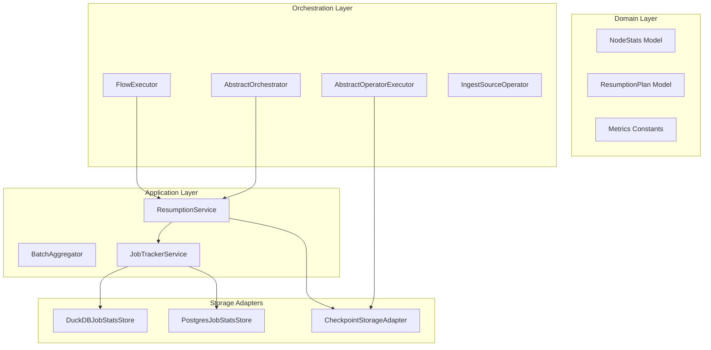

# Design: Node-Level Failure Resumption with Deferred Execution Tracking

## Context

See `proposal.md` for motivation. In Docling Pipelines, pipeline execution produces intermediate Parquet files per operator when configured with local or object data access (`DocpipeDataAccessLocal`). Document status and failure details per node are captured in `JobStatsStore`. However, on subsequent incremental executions, all un-finalized documents are evaluated from the root Ingest operator.

This design introduces a pre-execution **Resumption Planner** that identifies failed documents with valid upstream checkpoints, tracks them as `deferred_execution_docs` through upstream nodes, and injects their checkpoint data directly at the failure node.

## Goals / Non-Goals

**Goals:**
- Provide automated resumption of previously failed documents at their point of failure during standard incremental runs.
- Maintain mathematical consistency across node-level metrics: $\text{documents\_in\_scope} = \text{processed} + \text{deferred} + \text{failed} + \text{skipped}$.
- Validate source file timestamps so modified files automatically bypass stale checkpoints and re-ingest fresh.
- Enforce `max_retry_attempts` to prevent persistent poisons from retrying indefinitely.

**Non-Goals:**
- Cross-job checkpoint sharing.
- Structural DAG changes or schema mismatch recovery across versions.

## Architecture & DDD Layer Boundaries

### 1. Domain Layer (`src/docpipe/core/job_management/domain/` & `src/docpipe/core/orchestration/domain/`)
- `NodeStats`: Updated to include `deferred_execution_docs: list[str] = Field(default_factory=list)`.
- `ResumptionPlan`: Dataclass containing:
  - `deferred_docs_by_node: dict[str, list[DeferredDocInfo]]`
  - `bypass_ingest_ids: set[str]`
  - `stale_checkpoint_ids: set[str]`
- `Metrics.External`: Added `DEFERRED_EXECUTION_DOCS = "deferred_execution_docs"` and `DEFERRED_EXECUTION_DOCS_COUNT = "deferred_execution_docs_count"`.

### 2. Application Layer (`src/docpipe/core/orchestration/application/` & `job_management/application/`)
- `ResumptionService`:
  - Queries `JobStatsStore` for the latest failed documents of the job.
  - Queries retry counts and compares against `max_retry_attempts`.
  - Checks existence and timestamps of upstream checkpoint files.
  - Generates the `ResumptionPlan`.
- `NodeStatsAggregator` / `BatchAggregator`:
  - Updated to aggregate `deferred_execution_docs` across batches and maintain `total_expected = processed + deferred + failed + skipped`.

### 3. Orchestrator & Executor Layer (`src/docpipe/core/orchestration/`)
- `IngestSourceOperator`:
  - Ingests fresh documents.
  - For documents in `bypass_ingest_ids`, verifies `source_modified_time <= checkpoint_time`. If newer, marks as fresh; otherwise, marks as `deferred_execution_docs`.
  - Sets `documents_in_scope = len(fresh) + len(deferred) + skipped + failed`.
- `AbstractOperatorExecutor`:
  - Before executing node $K$:
    - If `resumption_plan` has deferred docs targeting node $K$, loads parent $(K-1)$ checkpoint Parquet rows, filters by ID, and concatenates with input table.
    - Removes injected doc IDs from `deferred_execution_docs`.
    - If node $K$ is not the target, propagates `deferred_execution_docs` forward in metadata.

## Decisions

### 1. Ingest-Level Accounting vs Silent Mid-DAG Injection
- **Decision**: Declare all deferred documents at Ingest and carry them in metadata as `deferred_execution_docs` until reaching their target node.
- **Rationale**: Prevents sudden spikes in `documents_in_scope` at downstream nodes and keeps metrics consistent from Node 1 to Node $N$.
- **Alternative Considered**: Injecting documents at Node $K$ without informing Ingest or upstream nodes. Rejected because upstream reports would show $M$ docs in scope while downstream reports show $M + D$, causing confusion in monitoring dashboards.

### 2. Source Modified Timestamp Comparison
- **Decision**: If source `modified_time > checkpoint_time`, invalidate checkpoint and ingest fresh from Node 1.
- **Rationale**: If a file was updated in source storage to fix an error, the upstream checkpoint is stale and the entire document must be re-extracted.

### 3. Retry Threshold via `max_retry_attempts`
- **Decision**: Introduce `global_config.max_retry_attempts` (default: 3).
- **Rationale**: Prevents unparseable or malicious files from cycling through retries on every scheduled incremental run.

## Risks / Trade-offs

- **[Risk] Checkpoint file missing or corrupted on disk** $\rightarrow$ **Mitigation**: If the checkpoint file cannot be read or deserialized, `ResumptionService` logs a warning and falls back to full root ingestion for those document IDs.
- **[Risk] Storage growth from retaining checkpoints** $\rightarrow$ **Mitigation**: Checkpoints are purged once all downstream nodes complete successfully or when `max_retry_attempts` is exceeded.

## Migration Plan

1. Non-breaking database schema migration: Add nullable `deferred_execution_docs` JSON column to `node_stats` table in DuckDB and PostgreSQL.
2. Backwards compatible: Flows without checkpoints or existing runs without `deferred_execution_docs` execute with empty lists.
