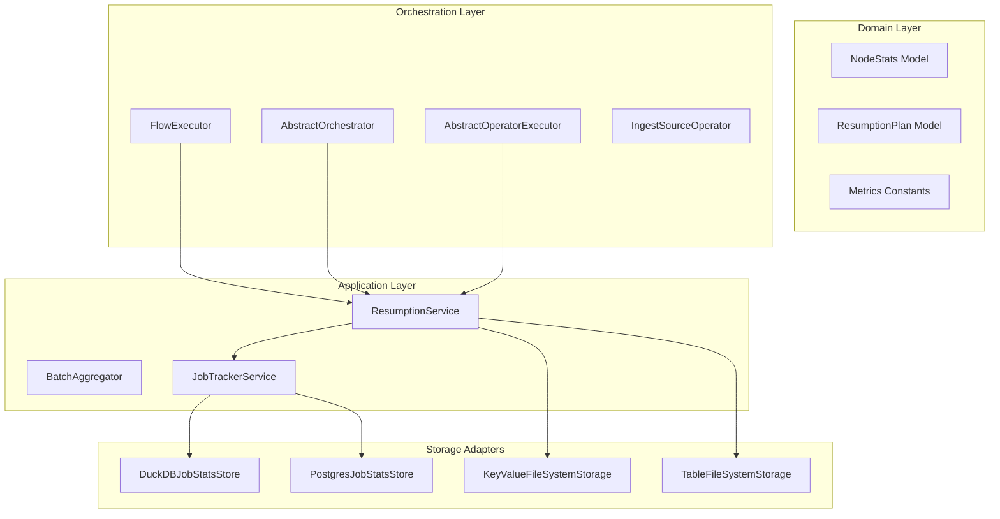

# Design: Node-Level Failure Resumption with Deferred Execution Tracking

## Context

See `proposal.md` for motivation. In Docling Pipelines, pipeline execution produces intermediate Parquet files per operator when configured with local or object data access (`DocpipeDataAccessLocal`). Document status and failure details per node are captured in `JobStatsStore`. However, on subsequent incremental executions, all un-finalized documents are evaluated from the root Ingest operator.

This design introduces a pre-execution **Resumption Planner** that identifies failed documents whose upstream node output is stored, tracks them as `deferred_execution_docs` through upstream nodes, and injects the stored rows directly at every node where they failed. No checkpoint copy is written: the rows are read from the intermediate node output that the executors already persist when `data_storage_type` is not `memory`.

## Goals / Non-Goals

**Goals:**
- Provide automated resumption of previously failed documents at their point of failure during standard incremental runs.
- Maintain mathematical consistency across node-level metrics: $\text{documents\_in\_scope} = \text{processed} + \text{deferred} + \text{failed} + \text{skipped}$.
- Validate source file timestamps against saved failure-time modification timestamps so modified files automatically discard their failure state and re-ingest fresh.
- Enforce `max_retry_attempts` (allowing `max_retry_attempts + 1` total attempts) to prevent persistent poisons from retrying indefinitely.
- Persist metadata for retry-exhausted documents to `IncrementalMetadataStore` and report them in the post-execution job run CSV report.

**Non-Goals:**
- Cross-job sharing of failure state or node output.
- Resuming a document at a node with several inputs (for example `merge`).
- Structural DAG changes or schema mismatch recovery across versions.
- Concurrent runs of the same `job_id` (a `job_id` is assumed to execute sequentially; concurrent runs of the same `job_id` are out of scope).

## Architecture & DDD Layer Boundaries

### 1. Domain Layer (`src/docpipe/core/job_management/domain/` & `src/docpipe/core/orchestration/{models,ports}/`)
- `NodeStats`: Updated to include `deferred_execution_docs: list[str] = Field(default_factory=list)`.
- `ResumptionRecord`: per-document failure state, stored through the existing `KeyValueStoragePort` (adapter `KeyValueFileSystemStorage`, collection `<job_id>/resumption`):
  - `doc_id`, `doc_name`, `modified_time`
  - `failed_nodes: list[FailedNode]`, one entry per node where the document failed (a document processed by several branches can fail at several nodes). Each `FailedNode` holds `node_id`, `node_name`, `job_run_id` (the run in which it failed), `failure_count`, `error_message` (the original error) and `exhausted`.
  - No checkpoint data and no data path are stored; the path is derived from `job_id` and `job_run_id`.
- `DeferredRecord`: a document scheduled for resumption at one node of the current run (`target_node_id`, `job_run_id`, `error_message`, plus the source node and output index resolved by the planner).
- The saved node output is read through the existing `TableStoragePort`. `TableFileSystemStorage` (new, `src/docpipe/storage/file_system/`) is a generic filesystem implementation of that port: a table is a directory and its rows are all Parquet files below it, so the per-node, per-batch folders written by the executors can be read as tables and queried with `execute_query`.
- `Metrics.External`: Added `DEFERRED_EXECUTION_DOCS = "deferred_execution_docs"` and `DEFERRED_EXECUTION_DOCS_COUNT = "deferred_execution_docs_count"`.

### 2. Application Layer (`src/docpipe/core/orchestration/application/` & `job_management/application/`)
- `ResumptionService`:
  - `record_failure` stores the failed node, the `job_run_id`, the failure count and the original error message. Failures at other nodes of the same document are kept.
  - Compares consecutive failure counts against `max_retry_attempts` (allows `max_retry_attempts + 1` total tries: 1 initial attempt plus `max_retry_attempts` retries). A document is exhausted when any of its failed nodes is.
  - `build_plan` resolves each deferred entry through `target_node_id` (the node is always part of the flow; a lookup by node name is used only as a fallback for authoring-format flows, whose node ids change on every compile) to its predecessor node, the output index (branching-aware) and the pending ancestors. All entries of one document go to the same micro-batch. Entries whose target is the ingest node, missing, or has several inputs are returned as unresolved.
  - `inject_saved_rows` reads the rows with `TableStoragePort.execute_query` (document ids are bound parameters), grouped by job run, source node and output index.
  - `clear_node_success` removes the failure entry of a node once a resumed document passes it; the record is deleted when no failed node remains.
  - Flags documents that exceeded `max_retry_attempts` retries for non-recoverable incremental metadata persistence; the failure reason includes the original error of every exhausted node.
- `JobReportGenerator` / `ReportGenerator`:
  - Formats report rows for retry-exhausted documents with status `Failed` and reason `Maximum retries exhausted (...) at node '<node_name>': <original error>`.
- `NodeStatsAggregator` / `BatchAggregator`:
  - Updated to aggregate `deferred_execution_docs` across batches and maintain `total_expected = processed + deferred + failed + skipped`.

### 3. Orchestrator & Executor Layer (`src/docpipe/core/orchestration/`)
- `IngestSourceOperator`:
  - Ingests fresh documents.
  - For previously failed documents, verifies `source_modified_time == saved_modified_time`. If newer (`source_modified_time > saved_modified_time`), marks as fresh and discards the failure record; otherwise, emits one deferred entry per failed node and marks the document as `deferred_execution_docs`.
  - Sets `documents_in_scope = len(fresh) + len(deferred) + skipped + failed`.
- `AbstractOperatorExecutor`:
  - Before executing node $K$:
    - If `resumption_plan` has deferred docs targeting node $K$, reads the rows from the stored output of the parent node in the job run where the document failed (`<data path>/<job_id>/<job_run_id>/data/<node>_<output>/output.parquet`, including per-batch folders), filters by ID, and concatenates with input table.
    - Removes injected doc IDs from `deferred_execution_docs`.
    - If node $K$ is not the target, propagates `deferred_execution_docs` forward in metadata.

## Decisions

### 1. Ingest-Level Accounting vs Silent Mid-DAG Injection
- **Decision**: Declare all deferred documents at Ingest and carry them in metadata as `deferred_execution_docs` until reaching their target node.
- **Rationale**: Prevents sudden spikes in `documents_in_scope` at downstream nodes and keeps metrics consistent from Node 1 to Node $N$.
- **Alternative Considered**: Injecting documents at Node $K$ without informing Ingest or upstream nodes. Rejected because upstream reports would show $M$ docs in scope while downstream reports show $M + D$, causing confusion in monitoring dashboards.

### 2. Source Modified Timestamp Comparison
- **Decision**: Save the source `modification_time` for failed documents at failure/ingest time. On subsequent runs, compare the current source `modification_time` against the saved `modification_time`. If current `modification_time > saved_modification_time`, discard the failure record and ingest fresh from Node 1.
- **Rationale**: Comparing source clock directly against saved source clock eliminates cross-system clock skew between external storage systems (e.g. S3, remote storage) and pipeline infrastructure, and ensures modified files are re-ingested from scratch.

### 3. Retry Threshold via `max_retry_attempts` & Failure Reporting
- **Decision**: Introduce `global_config.max_retry_attempts` (default: 3). A document is allowed 1 initial execution plus up to `max_retry_attempts` retries (total `max_retry_attempts + 1` attempts). When retries are exhausted (consecutive failure count reaches `max_retry_attempts + 1`), persist document metadata as non-recoverable in `IncrementalMetadataStore`, and report explicitly in the job run report together with the original error message.
- **Rationale**: Prevents unparseable or malicious files from cycling through retries on every scheduled incremental run, while giving operators clear visibility into the original error.

## Risks / Trade-offs

- **[Risk] Stored node output missing or unreadable** $\rightarrow$ **Mitigation**: If the saved output cannot be read or merged, the entry is reported as a failed document, its record is discarded, and the document is re-ingested from the root on the next run. Resumption is disabled when `data_storage_type` is `memory`, because nothing is persisted.
- **[Risk] Stored node output removed between runs** $\rightarrow$ **Mitigation**: The output of the run listed in the record is the only input. Cleaning up `<job_id>/<job_run_id>/data` therefore turns the affected documents into fresh ingests.
- **[Risk] Node ids change between runs for authoring-format flows** $\rightarrow$ **Mitigation**: Failure counting and planning fall back to the node name when no entry carries the node id, as long as the name is unique in the flow.
- **[Trade-off] `job_run_id` of repeated failures** $\rightarrow$ A document that fails again at the same node keeps the `job_run_id` of its first failure at that node, because that run holds the predecessor output; a resumed document is not part of the predecessor output of later runs.

## Migration Plan

1. Non-breaking database schema migration: Add nullable `deferred_execution_docs` JSON column to `node_stats` table in DuckDB and PostgreSQL.
2. Backwards compatible: Flows without failure records or existing runs without `deferred_execution_docs` execute with empty lists.
